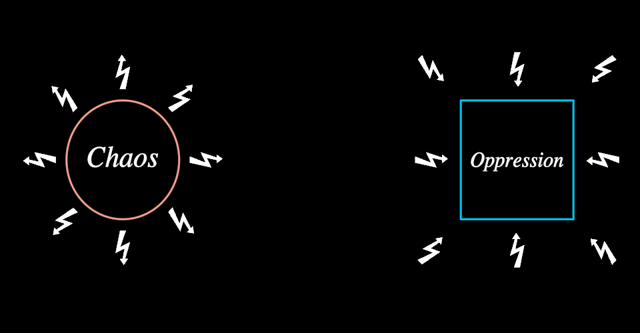

# Attractor (+ Dialectic)

One pole of the **freedom-order dialectic**, and the pathology it falls into
under fragmentation. Freedom and order are "clearly equally essential to any
healthy society", but "in a state of fragmentation, these complementary
qualities become conflicting ones" (1:02–1:07); "freedom times fragmentation
equals chaos, while order times fragmentation equals oppression" (1:57) — the
"two pathological attractors" a fragmented civilisation oscillates between
forever (2:21). David's 2024 DreamNode `CRI/ThirdAttractor` has the same pair.

**Attractor** — `kind` `chaos` (freedom's red circle) | `oppression` (order's
blue square, side 2R: it circumscribes the circle — the founding pair).
The circle and square are the founding holon's own (`holons/Circle`,
`holons/Square` are the core primitives); the bolts are `Conflict`'s ring.

| Param | Meaning |
|---|---|
| `size` | R, the circle's radius; everything is in units of it |
| `pathology` 0..1 | **state**: *freedom*/*order* (red/blue italic) → *Chaos*/*Oppression* (white italic) with eight bolts struck in and flown out — radiating round Chaos, striking in at Oppression (f480–f541) |
| `armed` 0..1 | the pole becomes a blue triangle (circumradius 2.2R) while the values attack each other (f380–f436) |
| `aim` | the triangle's apex turned from rest (chaos up, oppression down) |
| `label` 0..1 | labels shown (the oscillation's poles are bare, f736) |
| `presence`, `stroke` | whole-pole fade; pen width (2.3 px) |

**Dialectic** (`Dialectic.ts`, same DreamNode) — the arrangement the film
reuses whole (ch 1, 3, 4, 7): two Attractors, the Conflict between them, the
oscillation and the third axis. A second holon, not a param of Attractor,
because an Attractor stands alone as a symbol (the equations f601/f976,
censorship f4786, the 2024 face) while this is the composition of two of them
with what passes between — the poles stay one implementation, imported.

| Param | Meaning |
|---|---|
| `size`, `span` | R; pole centres at ±span·R (3.5 the dialectic f346, 5.05 with the third axis f1501) |
| `conflict` 0..1 | the bolt between strikes in (f346) |
| `armed`, `attack` −1..1 | triangles; who attacks whom — bolt and apexes turn together (f391 → f405 → f420) |
| `chaos`, `oppression` 0..1 | the poles' pathologies, promoted |
| `labels` 0..1 | the poles' labels |
| `swing` 0..1, `phase` (clock) | the glowing ball (golden glow), x = A·sin(phase); a blue pull toward order, a red one toward freedom, each stronger the nearer the ball is to the OTHER pole — "the closer we come to chaos, the stronger the impulse for order" (2:09) |
| `trace` 0..1 | the sine the ball has written hangs beneath it (f736–f1051) |
| `gaze` 0..1 | the domesticated eye (MolochEye, iris 0) under the ball (f1306) |
| `third` 0..1 | **state**: "an orthogonal degree of freedom moving from fragmentation to wholeness" (4:29) — the ball stills, a cross of axes, the founding `Cylinder` and the liminal eye (MolochEye, iris 1) above (f1381); an arrow rises (f1501); the ball travels up into the cylinder (f1530) — "the third attractor of wholeness" (4:55) |

Walkable: Attractor `pathology`; Dialectic `chaos`, `oppression`, `third`,
with `phase` as a clock. The equations (freedom × eye = Chaos, f601, f976
with exp()) are scene text compositions, not this holon.

**Proven by**: `docs/reports/interbrain/attractor-compare.png` (f346, f541,
f781, f1381, f1501 against `?scene=ib-attractor`), `test/ib-attractor.test.ts`.
