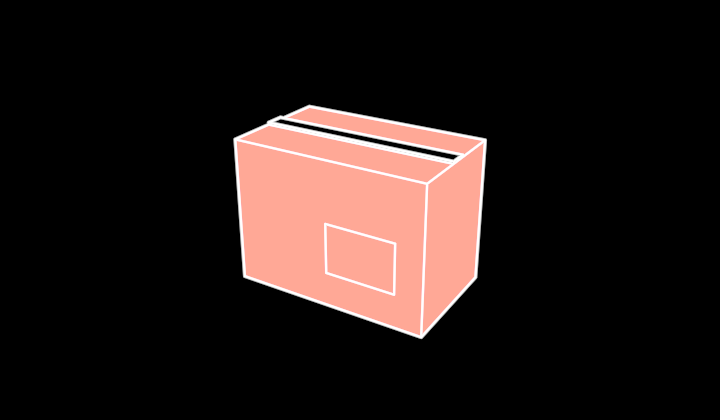

# Carton



A carton, platonic — products shipped by the box: a closed corrugated box,
a strip of tape over the seam where its top flaps meet, a label on its
side. The tape is what says CARTON rather than block. Visible 3D edges and
fills (`src/parts/soliddrawing.ts`).

```ts
carton = new Carton({ observer: this.observer, width: 160, height: 120, depth: 120 })
```

**Promoted params**: `material` (the board's colour — the product's
category), `width` (200), `height` (140), `depth` (120), `body` (tape and
label), plus the Stroke set. Origin at the middle of the bounding box.

**Why it exists**: the packaging vocabulary of the grain of knowledge
(`vocabulary/Grain`) — finished goods by the case. `/demo/?scene=materials-faces`.
