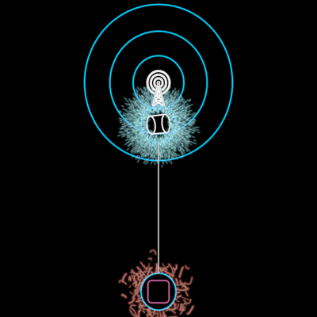

# CoherenceBeacon



"A medium that couples reach to coherence. Let's refer to this simple yet
powerful mechanism as the coherence beacon" (InterBrain film, 38:10–38:14)
— resonance as "the best measure for the coherence of the song" (37:14),
signal interfering constructively and noise destructively (35:28).

Two DreamNodes on one line (f11446–f11506, f11491 labelled "Coherence
Beacon"). Above, the coherent one — circle × square = cylinder, the
founding holon's resolved dialectic — bursting with cyan rays, a radio
tower on it, blue broadcast rings spreading round the tower. Below, the
incoherent one — circle + square = a muddied square — in a red swarm; it
fails and is gone by f11506. Composed: `DreamNode` ×2, the `Cylinder`
(`Cylinder.of(holons/Square, holons/Circle)` — their intersection, not a
copy), `Field` (burst and swarm). The rings and the link are its own lines.
The tower is a slot: `vocabulary/RadioTower` in the film, empty by default.

```ts
beacon = new CoherenceBeacon({ size: 69, tower: new RadioTower({ size: 130, solid: 0 }) }) // f11491
```

**Params**: `size` (S, the nodes' ring radius; f11491 33 px → 69),
`coherence` 0..1 (the rays' density and the rings' brightness), `reach`
0..1 (the rings grow out from the tower to 1.45 / 2.79 / 4.24 S, innermost
first, centred 2.27 S above the node), `noise` 0..1 (the incoherent node's
presence, 9.1 S below), `time` (the clock the rays and the swarm flow on),
`ringTint` (BLUE), `ringStroke`, `linkTint`; construction: `tower`, `face`,
`noiseFace`. `BEACON.tower` / `towerY` give the tower's film size and place.

**State**: `coherence` axis (faint ↔ beacon: coherence and reach together),
`noise` axis (gone ↔ there).

**Proven by**: `docs/reports/interbrain/beacon-compare.png` (f11491),
`test/ib-beacon.test.ts`, `?scene=ib-beacon`.

**Residuals**: `Field`'s burst sizes a ray by how far it travels, so the
film's long rays packed close to the rim read here as a wider, fuzzier
burst; and the beacon's face is not filled black (a fill hides the 3D
cylinder), so rays cross inside its ring. The incoherent node's face is
black, as in the film. The muddied square is the film's pink, sampled.
