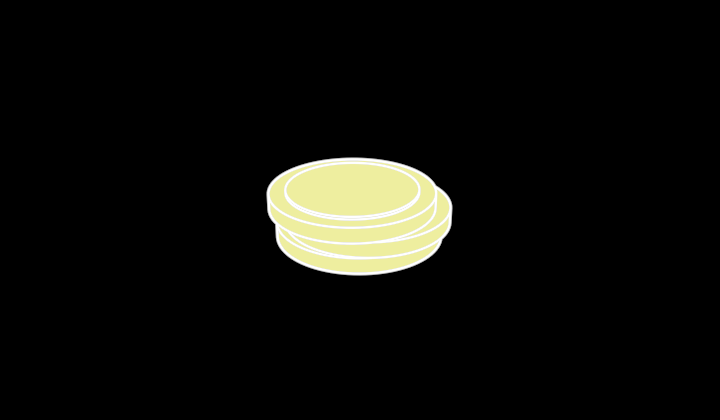

# Coin



A coin, platonic — value as money: a disc lying flat, its face a hair
proud inside the rim (one ring line), or a small stack of them, each a
little off the one below. One coin is the unit; a stack is what a flow of
money looks like up close. Visible 3D edges and a fill
(`src/parts/soliddrawing.ts`).

```ts
coins = new Coin({ observer: this.observer, count: 3, material: YELLOW })
```

**Promoted params**: `material` (the metal's colour — the currency's
category), `count` (1), plus the Stroke set. 100 across, 9 thick per coin,
lying in xz; origin at the middle of the bounding box.

**Why it exists**: the value ↔ money duality of a flow — a particle of
goods and a particle of money are both Grains (`vocabulary/Grain`), so a
dot can become a pallet on the way in and a stack of coins on the way
back. `/demo/?scene=materials-faces`.
