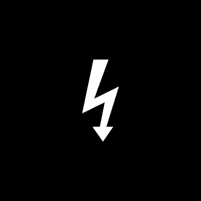

# Conflict



The white lightning bolt ⚡ — conflict itself. In the InterBrain film it
stands **between** two things that, under fragmentation, turn from
complementary into conflicting (freedom ⚡ order, 0:56 — f346, and turns
to point at one of them, f436); it **radiates** around the two
pathological attractors ("freedom times fragmentation equals chaos, while
order times fragmentation equals oppression", 1:57 — Chaos's bolts fly
outward from the red circle, Oppression's strike inward at the blue square,
f541); and it fills the war machine and the fragmented noosphere —
technology "amplifying conflict", "using conflict itself as a weapon"
(8:52).

One glyph, the high-voltage arrow: a thick slanted stroke, a jog back
across, a thinner stroke down to an arrowhead. A filled white shape, no
ink. Traced off f_00346 at full resolution (163 px), vertices fitted to the
frame's antialiased coverage (IoU 0.976). The Web3 video's blue node rings
its globe with the very same glyph (`demo/web3/YinYang.ts` imports this).

```ts
between = new Conflict({ size: 340 })                         // points down (f346)
chaos   = new Conflict({ size: 102, count: 8, radius: 261, direction: 0 })
oppress = new Conflict({ size: 102, count: 8, radius: 268, ring: "square", direction: Math.PI })
```

**Params**: `size` (length tail → tip; the one unit), `tint` (WHITE),
`fillOpacity`, `direction` (where a tip points — absolute for one bolt,
relative to its ring angle in a ring: 0 radiates, π strikes inward; default
−τ/4, down), `count` (1), `radius` (ring centre → bolt centre; on a square
ring, to the side), `ring` (`"circle"` | `"square"`), `phase` (first bolt's
angle). The bolt's origin is its bounding-box centre — the point the film
turns it about.

**State**: `spread` 0..1 — the ring gathered at its centre or flown out
("the bolts explode out", f535–f541). Walkable when `count` > 1.

**Create** is the film's strike: each bolt is revealed from its middle
outward along its length (f264 a dot, f265 the jog alone, f267 whole) —
`creation` is the revealed share, a slab clip of the outline.

**Proven by**: `docs/reports/interbrain/conflict-compare.png` (f346 IoU
0.977, f436 0.938 against the standalone scene), `test/ib-conflict.test.ts`,
`?scene=ib-conflict`, and the Web3 `?scene=yinyang` blue node.
