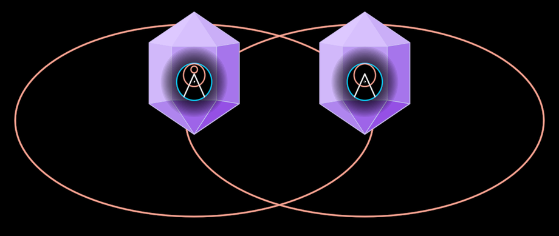

# DigitalCampfire

Two InterBrains, each in the red ring of its own world, the rings
overlapping into a shared space; in the middle two people sit at a
**symbol**, as they once sat at a fire.

**The concept.** "We do so by meeting our fellow dreamers around the
campfire. Just like we did in ancient times, we use symbols to enhance our
communication" (31:31) — and "with the addition of the digital campfire,
i.e. video calls, conversations and thus relationships can now reach around
the globe" (32:51). The film draws it twice in chapter 6 (f9451–f9601,
f9811/f9826), so it is a holon, not a scene.

**Face**: `?scene=ib-campfire` t≈3.5 (f9451). The demo then seats the two
(f9481), moves in as each bloom opens onto its garden (f9541), and clones a
node from one garden into the other and one back.

## Composed, never redrawn

`InterBrain` ×2, `SandTalk` (its own ring the faint ground, its fire banked:
here the symbol is the hearth), the `Vision` in its ring at the heart (any
symbol via `symbol`), a `DreamGarden` in each bloom. Its own marks are the
two shells (the vesica) and the two loops round the heads, open where they
meet the symbol (`loopPoints`).

## Params

Units of U = `size`, a shell's half-width (f9451: 371.5 px). Measured on
f9451: shell aspect 189/371.5, centres 0.953·U apart, crystal half-height
0.323·U, 0.25·U above its shell; on f9541 (the same picture ×2.4): SandTalk
0.269·U across, loops, symbol (`CAMPFIRE`).

`overlap` (0 two worlds apart … 1 the vesica), `talk` (the gathering's
presence), `gardens` (0 each bloom shows its Logo … 1 its garden),
`hearth` (0 banked … 1 the physical fire), `loopGap`, `shellTint`,
`shellStroke`, `shellOpacity` (the shells recede as the view moves in),
`groundTint`, `stroke`; construction: `leftCount`, `rightCount`,
`gardenRoom`, `symbol`. `gardenL`/`gardenR` are exposed for
`crossPollinate`.

## Proven by

`test/ib-campfire.test.ts` (vesica, crystals over shells, the banked fire,
gardens ↔ Logo, open mirrored loops);
`docs/reports/interbrain/campfire-compare.png` (f9451, f9481, f9541, f9501
against the render).
