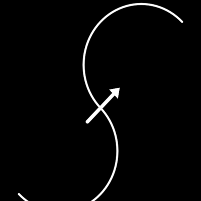

# Divide



The S that splits a whole into two lobes — the yin-yang's divider, drawn
wherever the films set two principles side by side as two phases of one
whole. In the Web3 film it is the thesis (centralised │ decentralised,
`demo/web3/YinYang.ts`, which imports this). In the InterBrain film it is
the medicine: **Engineering │ Gardening** (18:27, f5581, f5611 — a blue
square grid on the engineered side, a red flower of life on the gardened
side: "gardening plants seeds and nurtures soil; the garden emerges by
itself"), **Narrative Engineering │ Vision Gardening** (f5821), the open
S-arc with an arrow from the one sphere to the other (f2251, f5851, f6961),
and **DreamWeaving** (36:22, f10951; closed by a circle, f11071).

One geometry: two half-circles stitched where they touch. Lobe A (radius
`split`·R) is centred behind the waist, lobe B (the rest) in front; the S
runs under A's centre and over B's. Every frame above is this curve —
f5851 measures two true semicircles (182°, 181°) on an axis at +45°; f5581
is the same S at R 760 px, clipped by the frame. Lobe A is the engineered,
blue side (lower-left), lobe B the gardened, red side.

```ts
frame = new Divide({ radius: 1583, turn: FILM_TURN, stroke: 7, fieldA: "grid", fieldB: "flower" }) // f5581
arc   = new Divide({ radius: 646, turn: FILM_TURN, stroke: 5, arrow: 1 })                          // f5851
whole = new Divide({ radius: 300, outer: 1 })                                                       // f11071
```

**Params**: `radius` (R, half the S's span), `split` (lobe A's share),
`turn` (the axis; `FILM_TURN` = τ/8), `tint`, `stroke`, `segments`;
`outer` (the enclosing circle's draw-on), `outerTint`, `outerStroke`;
`arrow` (the arrow's draw-on — across the waist, along the axis, A → B),
`arrowLength` (× R, 0.32 from f5851), `arrowStroke`, `arrowHead`;
`fieldA` / `fieldB` (`none` | `grid` | `flower`, construction), `tintA`
(BLUE), `tintB` (RED), `fieldOpacity` (0.12 — the film's fields are dim),
`fieldStroke`, `gridCell` / `flowerCell` (× R, f5581: 124 px and 115 px of
760), `fieldReach` (half-size of the filled square, × R). The fields lie in
the holon's unrotated frame, clipped to their side of the S (a point is on
A's side inside A's disc, on B's inside B's, else by the axis line).

**State**: `split` — the lobes trade sizes (B swells 0.125 · even 0.5 ·
A swells 0.875: the Web3 spin's exchange).

**Create**: the fields fade up, the S draws as one stroke, then the circle
and the arrow.

**Proven by**: `docs/reports/interbrain/divide-compare.png` (f5581, f5851),
`test/ib-divide.test.ts`, `?scene=ib-divide`, and `?scene=yinyang` —
pixel-identical before and after the pop-out at t 2.5 / 6.5 / 9 / 14 / 18.
