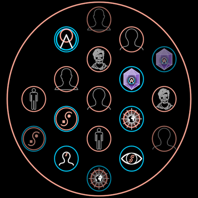

# DreamGarden

Your DreamNodes held together **without any imposed structure**: a large red
ring, the nodes packed inside it as they come — dreams in blue rings,
dreamers in red, no node above another.

**The concept.** "Rather than organizing our dream nodes in a hierarchy of
categories in our vault, we store them without any imposed structure in
what we might call our dream garden. Here, we simply let the web of
relationships emerge organically" (31:10) — by cross-pollinating our garden
with those of others, around the campfire: "for every DreamTalk symbol we
invoke, the corresponding dream node is cloned into each other's dream
garden" (31:43). Over time it self-organizes into your
[LiminalWeb](../LiminalWeb/).

**Face**: `?scene=ib-dreamgarden` t≈5.5 (f9406); then a second garden comes
beside it and a node is cloned from each into the other.

## Construction

The nodes sit on a **hexagonal lattice** (the closest packing — what a heap
of seeds does by itself), vertical columns, filled from the middle outward:
19 is f9406's 3-4-5-4-3. Measured on f9406: ring 259.6 px, step 106.5 px,
node ring 33.5 px. The step is fitted so the outermost node's edge sits at
`GARDEN.fit` (0.9495) of the ring for any count; 19 gives the film's exactly.
The rim fades (f9406's corners): a node whose edge passes 0.86 of the ring
dims towards `rim`.

## Params

`radius` (the ring; everything follows it live), `count`, `seed` (which node
goes where and wears which face), `dreamers` (share of dreamers), `room`
(free slots kept for nodes it will receive) — these four are read at
construction. `ringTint`, `ringStroke`, `ringOpacity` (0 inside an
InterBrain's bloom), `nodeStroke`, `rim`. `plants: Plant[]` overrides the
seeded planting.

Faces are other symbols, imported: `DREAM_FACES` (Logo, InterBrain,
DreamTalkSymbol, Vision, MolochEye iris 1, Mind liminal) and
`DREAMER_FACES` (Sketch `david`, `individual`, `headFront`, Figure bust).

## Abilities

**Cross-pollination.** `garden.crossPollinate(i, other, frame, slot?)`
returns a `Pollen`: a clone of node i (same kind, a fresh face) whose
`flight` (0..1) carries it on an arc (`lift`) from its place here to
`other`'s first free slot, taking that garden's node size. Both gardens are
read in `frame`, live; place the Pollen there. Its Create is the clone
coming up on the source, then the flight.

`slot(i)` / `slotIn(i, frame)` give any slot's place; `rimAt(i)` its fade.

## Proven by

`test/ib-dreamgarden.test.ts` (lattice, fit to f9406, packing, rim, seed,
room, pollen endpoints); `docs/reports/interbrain/dreamgarden-compare.png`
(f9406, f9541 against the render).
