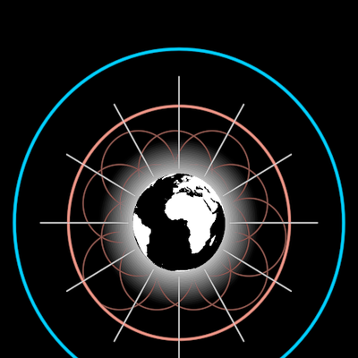

# DreamNode

The digital vehicle of a DreamTalk symbol: **any symbol inside a ring**.

**The concept.** "A DreamTalk symbol needs a digital vehicle, one that is
able to hold space for the living, evolving knowledge the symbol
represents" (29:14) — a git repository, generalised from software to "the
entire class of knowledge itself"; "let's refer to this generalized digital
vehicle as a dream node" (30:11). It tracks an idea "from humble seed all the
way to mighty vision". There are two complementary kinds (30:44): the
**dreams** we share (a blue ring) and the **dreamers** we share them with (a
red ring, holding a portrait). And they nest: "take any number of dream nodes
and combine them into larger wholes by importing them into a higher-order
dream node" (35:43).

**Faces**: `?scene=ib-dreamnode` — the face above is t≈3.5 (f9076); the ring
draws on from one o'clock, clockwise, as the film's does when "GitRepo" is
said (f8812–f8820); then dreamer and back; then the holarchy of f10760.

## Params

`radius` is the ring's, and the face follows it live: whatever the symbol,
its outermost reach sits at `faceFill` (0.84, measured on f9076 and f9271) of
the ring. A face states its reach with a `reach` getter (DreamTalkSymbol: its
ray tips; InterBrain: its apexes), else its `radius`, else half its `height`.

`kind` is one number, 0 = dream, 1 = dreamer (`kind: "dream" | "dreamer"`
reads at construction), walkable as the `kind` axis (`k`). The ring runs
`dreamTint` (BLUE) → `dreamerTint` (RED). Given no `face`, the node holds
both defaults — a [DreamTalkSymbol](../DreamTalkSymbol/) and David's
portrait (`vocabulary/Sketch` `david`) — and they swap on `kind`, one
shrinking into the heart as the other grows out. `face: someHolon` holds
that symbol alone; `face: null` holds nothing but children. `ringStroke`,
`ringOpacity`.

## Abilities

**Holarchy.** `children: DreamNode[]` are held inside, `childShare` (0.27)
of the ring each, evenly round an orbit of `childOrbit` (0.55), the first at
`childPhase` (the bottom) — f10760's layout. Each child is a full DreamNode,
so it nests to any depth, and all of it follows the parent's `radius`.

**Import lines.** `ImportLines({ between: [node, copy], frame })` draws the
two outer tangents of two rings, read in a common frame (`circleIn`), live —
the film's cone from a node to its copy inside a higher-order node (f10760,
f10846). `outerTangent` is the construction.

## Proven by

`test/ib-dreamnode.test.ts` (face fit, kind endpoints, live holarchy layout,
tangency); `docs/reports/interbrain/dreamnode-compare.png` (f9076, f9271,
f10760 against the render).
