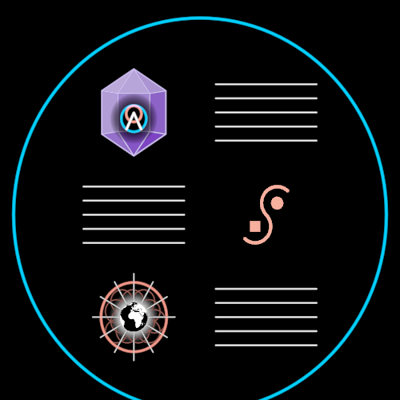

# DreamSongSymbol



DreamTalk symbols woven into a larger story, held in one DreamNode. "The
corresponding DreamTalk symbols can then be woven together to tell a
larger story or dream song … this new and ancient practice of integrating
many DreamTalk symbols into a single DreamSong as Dreamweaving. By
compressing a DreamSong in turn again into a single DreamTalk symbol, we
can weave it into yet another higher order DreamSong" (InterBrain film,
36:14–36:42).

The film draws it as a blue-ringed DreamNode holding a page — symbols and
blocks of text (stacks of lines) in two columns, checkerboarded (f10906,
f10966); beside the DreamTalk symbols it weaves (f10921); and compressed
into one symbol, the Logo (f10981–f11011). Composed: the ring is
`DreamNode`, the symbols are whatever the slots hold (default `InterBrain`,
`Vision`, `DreamTalkSymbol`), the compressed face is `Logo`. Only the text
blocks are its own line work.

```ts
song = new DreamSong({ radius: 485 })                                        // f10906
mine = new DreamSong({ slots: [a, "text", "text", b], compressed: myLogo })
```

**Params**: `radius` (the ring; f10906 233 px → 485), `ringTint` (BLUE),
`ringStroke`, `lines` (per text block, 5), `textTint`, `textStroke`,
`slotReach` (a symbol's reach × the ring, 0.22). Construction data:
`slots` (the page in reading order, two to a row: a holon or `"text"`),
`compressed` (undefined: the Logo; null: none). Measured on f10906: columns
±0.355, rows 0.52 apart, text 0.54 wide with lines 0.0717 apart; on f10996
the Logo's circle is 0.712 of the ring.

**State**: `compress` 0..1 — the song folds into its single symbol: the
page shrinks into the heart and fades as the compressed face grows out of
it (walkable: song ↔ symbol, key `x`).

**DreamWeaving** (f10951) is a composition, not a holon: `Divide` at
`FILM_TURN` with the DreamTalk nodes in the lower lobe and the DreamSong in
the upper (`?scene=ib-dreamsong`, beat 2). The same scene builds the
founding holon as DreamSongs: circle × square = cylinder inside a DreamNode
(f11311; the cylinder is `Cylinder.of(holons/Square, holons/Circle)`) and
circle + square = a muddied square (f11401).

**Proven by**: `docs/reports/interbrain/dreamsong-compare.png` (f10906,
f10996, f10951, f11311, f11401), `test/ib-dreamsong.test.ts`,
`?scene=ib-dreamsong`.

**Residual**: the film's page holds a "liminal eyes" symbol (two almond
eyes with the Vision as a third eye) — no holon carries it yet, so the
default page shows `Vision` in that slot.
