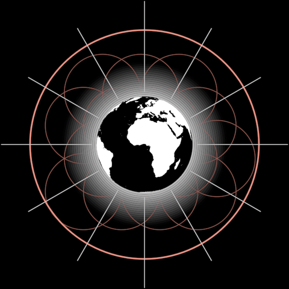

# DreamTalkSymbol

A DreamTalk symbol: the Earth inside a white bloom, a red flower of life, a
bold red ring and twelve rays of light.

**The concept.** The InterBrain film draws exactly this symbol and names it
"Digital SandTalk" (f8746): SandTalk, the aboriginal practice of drawing
symbols in the sand while talking, carried into the digital — "let's refer
to the digital extension of SandTalk as DreamTalk" (29:08). To travel
through the InterBrain "a DreamTalk symbol needs a digital vehicle" (29:14):
the [DreamNode](../DreamNode/) that rings it. DreamTalk is also this
framework's own name, so the holon is named for the symbol.

It was first built for the Web3 video as `LightNode` — the hero of shot 15,
the red lobe of the yin-yang (shots 2–3), and the hero panel of GlobeDemo.
One symbol, so one holon. Before that it was drawn three times, each copy
with its own drifted constants. `vocabulary/LightNode/LightNode.ts` is now a
thin re-export of this class (boards saved with `lightNode` open as
`dreamTalkSymbol`, sketch/board.ts `RENAMED_SYMBOLS`).

**Faces**: `?scene=web3s15` (the face above is t≈8); inside its ring,
`?scene=ib-dreamnode`.

## Params

`radius` is the red ring's radius, and every part follows it live, so one
param swells or shrinks the whole symbol. `globe` is the Earth's share of the
ring (the hero measured 83/198, the lobe 0.415). The Earth turns on `spin`
and leans on `tilt`, and its land floods in on `landOpacity`. Each layer
has one presence: `bloomOpacity`, `latticeOpacity`, `rayOpacity` and
`ringOpacity`. Their tints and strokes are promoted. The bloom's shape is
set by `bloomRings`, `bloomSpread`, `bloomStrength` and `bloomFalloff`.

The Earth is set on the page (`src/parts/recede.ts`), so the bloom and
lattice pass behind its black sea and the ring lies over it. A scene whose
camera is not the default calls `symbol.seenFrom(this.observer)`.

## Proven by

Web3 shots 2–3 (red lobe) and 15 (`?scene=web3s15`, identical before and
after the rename); GlobeDemo; the InterBrain DreamNode (f9076).
