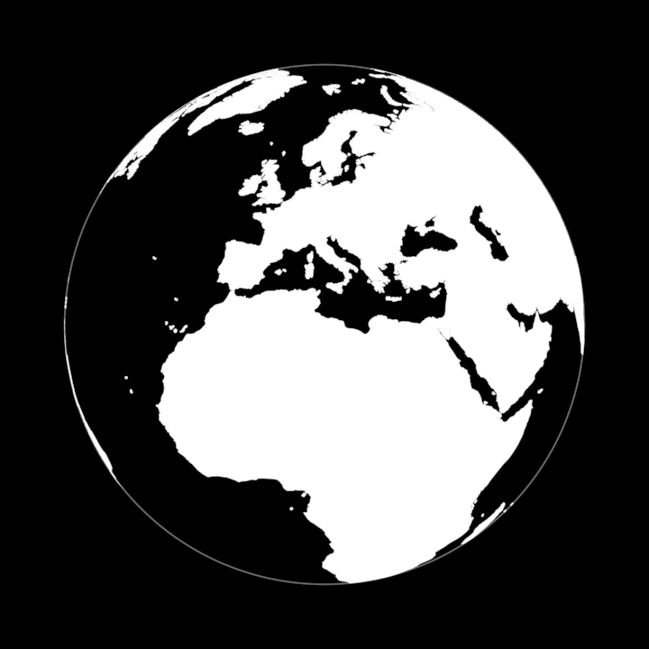

# Earth



The planet as one programmatic object: a true 3D sphere with its land filled on the sphere, its coastlines and country borders as strokes lying on the surface, and its far side hidden by depth. Black by default, land white. It can be turned, drawn on, zoomed into and built upon. Every coordinate comes from Natural Earth; none of it is drawn by hand.

**Faces**: `?scene=earth`. The black Earth turns from the Atlantic to Europe while its shore draws on and the land floods white. The eye then descends and tilts like Google Earth, the land dims so the borders can draw in, and a headquarters rises out of the ground in Austria with ten production sites after it, red and blue. The face above is the whole Earth at t≈7.2.

## What it is

| Part | What | Param(s) |
|---|---|---|
| ball | the ground: a solid sphere 1% under the surface. It hides whatever is underground, such as a building waiting to rise | `sea` |
| horizon | the occluder: a solid disc on the horizon plane, rebuilt from the camera | `sea` |
| land | triangle sheets **on the sphere**, one per LOD rank | `land`, `landOpacity` |
| coast | ~1,600 shore runs, derived from the land rings | `coastTint` `coastStroke` `coastOpacity` `coastDraw` |
| borders | 393 admin-0 land boundaries | `borderTint` `borderStroke` `borderOpacity` `borderDraw` |
| limb | the silhouette circle as a stroke (off by default) | `limbTint` `limbStroke` `limbOpacity` `limbDraw` |
| places | whatever a scene anchors (`Place`s, and `Connection` arcs between them) | `places` |

**Optional layers.** Each is off by default, ranked for LOD like the land, and built from the same pinned Natural Earth source:

| Layer | What | Param(s) |
|---|---|---|
| graticule | meridians and parallels every `graticuleStep`° (15), with a finer third arriving at map zoom 3 | `graticuleTint` `graticuleStroke` `graticuleOpacity` |
| lakes | lake water (sheets on the sphere over the land) and their shores | `lake` `lakeOpacity` |
| rivers | rivers and lake centrelines | `riverTint` `riverStroke` `riverOpacity` `riverDraw` |
| countries | any country's territory as its own sheet, by ISO alpha-2: `highlight: ["AT", "EG"]`, then `earth.country("AT").fillOpacity.to(0.85)` | per-country `tint` `fillOpacity` |
| labels | country names (capitals, tracked) and city names (with a dot): `labels: { countries: 5, cities: 4 }` builds those with Natural Earth min_label / min_zoom up to the given values. They face the camera, keep a constant pixel size, fade in with `detail` and out toward the horizon, and composite over the land as an overlay | `labelTint` `labelOpacity` `labelSize` `labelBias` |

| night | the side away from the sun (`sunLat`, `sunLon`) darkened, softened across a `twilight`-degree band in 12 steps; the terminator as its own stroke | `nightTint` `nightOpacity` `terminatorTint` `terminatorStroke` `terminatorOpacity` |
| (no map lines) | construction-time `mapLines: false` builds none of the coasts, borders, lake shores, rivers or graticule (≈3,300 Line holons) — for a globe that only ever shows land, limb and night (FragmentedEarth, DreamTalkSymbol, Worldview's lens Earth); their params remain and drive nothing | `mapLines` |
| atmosphere | a hatched halo outside the limb: the silhouettes of 7 slightly larger spheres, fading outward | `atmosphereTint` `atmosphereOpacity` `atmosphereWidth` |
| light | the land lit radially from a place, `land × (1 − lightFalloff · smoothstep(0, lightReach, d))` (Web3's LightSpread) | `lightLat` `lightLon` `lightFalloff` `lightReach` |

**Data layers: give any piece of information a home on the planet.** Each is fed by a plain table:
- `Choropleth({ data: { AT: [..12 months..], … } })` gives every country its own sheet, tinted along a quiet ramp from `low` to `high` by its value at `period`. The period is continuous and values are interpolated between periods, so a year is one smooth param. Missing values are ghosted in DreamTalk's own language for uncertainty: faint, never gone, crossfading as data begins or ends. Pass it to `layers`, which draws over the land and under the lakes, coasts and borders.
- `PointData({ rows: [{ lat, lon, values }] })` stands each row on the ground as a Place, either as a column (height ∝ value, line-drawn with true hidden lines) or as a disc (area ∝ value). `strength` raises them all out of the ground.
- A `Connection` carries traffic when given `particles`. Short dashes run the great-circle arc from its first place to its second, using FlowMap's stream functions (`streamArc`, `streamFade`). `volume` controls how many are on the arc and how heavy each is, and `time` is a clock that keeps running in free play.

`?scene=earth-data` shows a mock year: a value per country, columns at eight places, and six flows into one hub.

**A visual automaton.** In free play (`?play=free` or Space), the Earth's own axes are keys:
- **n**: time, cycling day → dusk → night (the sun's place and the night shown together)
- **d**: land, white globe ↔ dim map
- **b**: borders
- **w**: water (lakes and rivers)
- **g**: graticule
- **a**: atmosphere
- **l**: labels, when they were built

Every transition is interruptible and reversible, and a scene can take the same paths on its timeline (`this.play(earth.stateAxis("time").to("night"), 2.4)`). `keepOut()` keeps the viewer's orbiting eye 2% above the ground, so a hard drag rolls over the planet instead of going black.

**Labels declutter** in a fixed priority order: rank, then capitals, then population, with countries before the cities inside them. A label yields by how much of its padded screen box is already covered by stronger labels, weighted by their opacity. The boxes are measured: each name's width comes from the glyph advances of the face it is set in (`src/geometry/fonts/arimo.ts`), plus tracking. It is continuous, so names cross-fade instead of flickering as the camera moves, and it keeps no state between frames, so scrubbing backwards shows exactly what playing forwards showed. The horizon fade measures the sight line's elevation at the label, so it behaves the same at every altitude.

**1:10m detail packs.** `new Earth({ packs: [ALPS_10M] })` draws every layer from Natural Earth 1:10m inside the pack's box and from 1:50m everywhere else. The region is a set of the triangulation's own grid cells: fills from the two datasets meet exactly along the cell lines (world land area unchanged to 0.05%), and strokes are cut where they cross the region's edge. A pack is generated by `gen-data.ts --pack <name> <west,south,east,north>` and is imported only by the scenes that need it, so the Earth's default bundle doesn't grow. `packs/alps10m.ts` covers 5–20°E, 44–50.5°N in **80 KB**: land 2.5k, borders 6.1k, lakes 0.4k, rivers 6.4k and country rings 13k points.

`?scene=earth-features` shows them all, along with the two camera verbs below.

`coastDraw`, `borderDraw` and `limbDraw` are each **one** param shared by every Line in their set. The whole shore draws on together, and the borders can arrive on their own later. `detail` is the map zoom the Earth is drawn for. Each feature carries Natural Earth's own `min_zoom`, and anything ranked above `detail` fades out. At any half-integer `detail` every feature is wholly in or wholly out.

**How the far side is hidden.** A point on a sphere is visible from an eye exactly when it lies in front of the horizon plane (p·ĉ > R²/d). The occluder is that plane, filled to the horizon circle: it is exact for everything on the surface, and it is flat. Using the ball itself as the occluder was tried and measured. Its depth is steep near the silhouette, so it either eats the inner half of every front stroke or, when depth-biased, leaks the far side's coasts as an arc along the limb. `seenFrom(observer)` gives the Earth the camera, and `followEarth` calls it. An Earth that is never told assumes the framework's default observer.

## API

```ts
const earth = new Earth({ radius: 400, coastDraw: 0, landOpacity: 0, places: sitePlaces(MOCK_SITES, { sunk: true }) })
earth.latLonToLocal(48.2, 16.4)          // a surface point in the Earth's frame (+ altitude)
new Place({ lat, lon, altitude, members }) // seats members at lat/lon: +y up, +x east, +z south
const view = new EarthView({ lat: 18, lon: -62 })
followEarth(this.observer, earth, view, { detail: 2 }) // the observer flies the view; LOD follows the descent
FrameRegion(view, { lat: 49, lon: 12, span: 17 }, { earth, observer: this.observer }) // whole planet → Europe
view.tilt.to(38)                         // lean off straight-down, looking north
```

`new Connection({ ends: [site, hq] })` is a great-circle arc lifted off the surface (higher for longer reaches) whose pen runs from its first place to its second. It states its curve in world space (`worldCurves()`), which is what MorphCurves/MorphMany read. Shorelines also have screen-size LOD: a feature narrower on screen than 2–4 pen widths keeps its fill and drops its outline, so thin islands never read as doubled lines.

**Going places.** `Focus(view, { lat, lon, zoom | span, tilt })` moves straight there. `FlyTo(view, target)` rises `pullBack` levels below the target's zoom, crosses, and comes down on it, easing the tilt off for the crossing. Both are pure in what they are given, so they compose anywhere on a timeline.

`EarthView.zoom` is log2 magnification (each +1 halves the altitude), so animating it at an even pace descends at an even pace for the eye. Rising buildings animate `place.altitude` from sunk to 0, and the ground hides them until they break the surface.

**Sites** (`Sites.ts`): plain data, `{ name, lat, lon, kind: "hq" | "red" | "blue" }`. A real dataset swaps in for `mockSites.ts`. The positions there are invented and generic, and the names are placeholders, because this repo is public. `Factory` (a sawtooth-roofed hall) and `Headquarters` (a tower on a podium) are prisms (`prism.ts`) drawn as lines. Their black solid bodies write depth, which gives true hidden lines from the GPU at any camera angle. Both are `Building`s (`prism.ts`) and so morph targets: give one `seenBy: () => observer`, and `worldCurves()` returns its VISIBLE edges in world space (hidden-line removal on the prisms' own meshes, plus the Headquarters' floor lines where their face is seen), so `MorphCurves([truck], [factory])` lands on what the camera shows.

## The data

Natural Earth 1:50m, public domain: "No permission is needed to use Natural Earth". The layers are `ne_50m_land` (fill, and the coast derived from it) and `ne_50m_admin_0_boundary_lines_land`, fetched from `nvkelso/natural-earth-vector` at the pinned tag **v5.1.2**. `bun vocabulary/Earth/gen-data.ts` regenerates `naturalEarth.ts` byte for byte, and `--from <dir>` reads local GeoJSON instead. The packing (`codec.ts`) is a 1/1000° grid with zigzag varint deltas in base64. It holds 60,669 land points and 19,758 border points in **305 KB**, against 2.4 MB of GeoJSON. The optional layers are packed in `naturalEarthFeatures.ts` (**441 KB**), each on its own grid:
- lakes: 18.6k pts at 1/1000°
- rivers: 25.6k pts at 1/500°
- the 242 country polygons: 99.6k pts at 1/200°. They lie under the 1/1000° coast and borders, so half a kilometre is never seen, and most steps fit in one byte.
- 356 cities: every capital, plus every place ranked by zoom 4.

The Earth's data totals about **750 KB**. The land file regenerates byte-identical.

**Construction**: `geometry/sphere.ts` triangulates the land on the sphere. Rings are clipped to the six faces of a cube in 3D, each face is cut into a 64×64 equi-angular grid in its gnomonic chart (where great circles are straight), and every cell is ear-clipped. Every triangle stays about 1.4° across, so the land hugs the sphere, and cells share their boundary vertices, so the surface has no cracks. The triangulated land area (28.74% of the sphere) matches the exact ring integral of the data to 0.1%. Strokes are densified to ≤ 0.5° steps in lon/lat, the way the data was drawn: the 49th parallel stays a parallel.

## Promoted params

`radius` (construction), `sea`, `land`, `landOpacity`, the coast/border/limb tints, widths, opacities and draws, and `detail`. The Earth turns with its own `h`/`p`/`b`. `EarthView` exposes `lat`, `lon`, `zoom`, `tilt` and `fill`.

## Not yet

More detail packs (a Europe-wide one will be large: Norway's 1:10m fjords alone are tens of thousands of points), admin-1 regions, and terrain relief.
