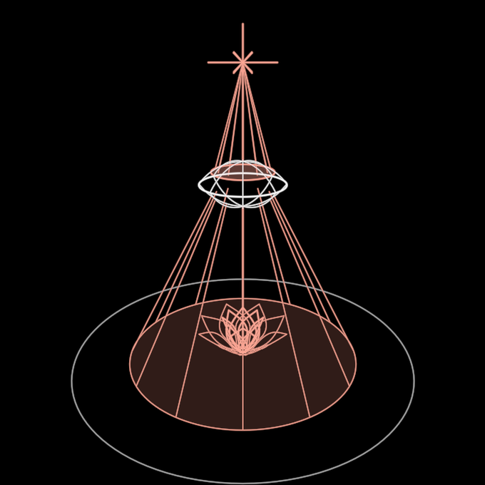

# EgoLens

The ego as a lens between the light and the land. The ego is the king of the
psyche: it is subservient to the light above and serves the other psychic
functions below. Its relationship to the light is right or wrong, and the
symbol walks that relationship as one axis.

**Real 3D: one vertical line and one horizontal plane.** A star sits on the
axis above, the lens on the axis in the middle, and the land is a horizontal
disc below with a lotus at its centre. Y is up. The symbol can be orbited.

## The relation: `relation` −1 … 0 … 1 (walkable: click the symbol or press its digit)

| relation | position | what happens |
|---|---|---|
| −1 | `away` | the lens turns from the light: it turns right over, its face (the red ring where the light enters) down to the dark and its back (a blue ring) up to the star. The rays end on its back and nothing passes. Its shadow lies cold on the dimmed land, and the lotus droops and curls under (blue, cold) |
| 0 | `icon` | right relationship. The light refracts through the lens and spreads over the land in a red pool, and the lotus opens toward it (red, warm) |
| 1 | `deep` | it looks too deep into the light and takes itself for the Self. The lens becomes the eye whose section it is: first the clear eye, then burning — the flaming, lidless eye of the watchtower ([RingEye](../RingEye/)'s `WatchEye`: the lids give way to fire, the iris glares, the pupil narrows to a slit). The eye rises toward the star, the star shrinks, and every ray is drawn into the eye. Nothing reaches the land, and the lotus closes to a bud |

Esc returns to `icon`. The axis carries no fixed key, so the player assigns
a digit and a whole can rekey it. A whole that drives `relation` itself takes
the axis.

**The lens is the eye's section.** The lens body is MolochEye's 3-4-5 lens
turned about the vertical: the rim is 2h and the faces have radius 2.5h
(`LENS_RADIUS_RATIO`). Each meridian is exactly the eye's almond. Seen
edge-on, the ego-lens is the outline of the eye it can become, and the
cyclops is drawn at the lens's own h. The eye always stands upright, turned
toward whoever looks; its `gaze` follows the relation (clear as it opens,
burning by `deep`).

**The face and the back.** On the lens's upper face, the one turned to the
star, a red ring marks where the light enters; on the lower face a blue ring,
its back, shows only as it turns away. Each is bright while it faces the eye
and faint as the far side, so turning over reads in a line drawing.

**The rays** run from the star to the first point where they meet the lens
body (the intersection of the two face balls), however the lens is turned.
In `icon` they leave the lower face and spread to the pool's ring.

**The lotus** has two rings of eight cupped petals, the outer ring offset by
half a step. `bloom()` follows the relation: 1 open, 0 a closed bud, −1
drooping and shrivelled. `petalOutline` is the petal as a pure function.

## Params

- `size`: the whole height, star to land. It is the one size, and `reach`
  is half of it.
- `relation`: the state.
- `stroke`: the pen in screen px. Rays, petals of the outer ring, meridians
  and the land use 0.6 of it.

The proportions are in `EGOLENS`, in units of `size`. Readings for a whole
that weaves the symbol are `away()`, `deep()`, `lit()` (how much light
reaches the land) and `bloom()`. `seenFrom(observer)` turns the eye toward
that observer; otherwise it turns toward the live camera.

Create: the star shines, the light comes down the axis and through the lens,
the land receives it, and the lotus opens.

Scene: `/demo/?scene=egolens` (add `&play=free` to walk it). Proven by
`test/egolens.test.ts`.
