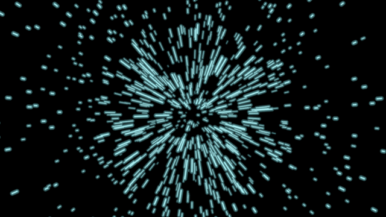

# Field

The particle field that carries the InterBrain film's mood — the ground
behind the symbols, whose colour IS the chapter's argument.

**The concept.** Red, it is **fragmentation**: the human family divided
against itself (0:20), reality broken into separate parts. When the ball
leaves the oscillation between the two pathological attractors along the
orthogonal axis, the field turns: "the third attractor of wholeness … the
natural state of unity in which the paradox is resolved" (4:29–5:14). The
red streaks stop, whiten, and a cyan starburst accelerates out of the
centre (f1561 → f1621; again f11611 → f11661).

**One holon, three looks** of one machinery (seeded particles, each a pure
function of time, drawn as 4 brightness bins × 4 soft layers of
`Polylines` — 16 draws whatever the count):

| `mode` | what | film |
|---|---|---|
| `warp` (default) | streaks flying out of a vanishing point at the viewer: depth falls linearly, screen radius ∝ 1/depth | f556, f736, f1036, f1621 |
| `burst` | thin rays born at a circle's rim, travelling out and fading | f12016, f12136, f12706, f12721 |
| `swarm` | curly strands wandering about a shape (each strand is the last instant of its particle's own wander); `dissolve` blows them away | f46, f12661, f6586, f6826 |

**State**: `wholeness` 0..1 — the one axis the film morphs through
(`stateSpace()` axis `wholeness`: fragmented / whole; `time` is a clock).
0 red, blurred, slightly misaligned streaks · 0.5 the white pause: every
streak shrinks to a dot · 1 cyan, crisp, exactly radial — a wave of
acceleration has spread from the centre (`WAVE_REACH`), dots still waiting
beyond it. Wholeness never changes a particle's phase, so the turn never
makes anything jump.

**Params**: `mode`, `time`, `wholeness`, `density` (nested subsets —
thinning never reshuffles), `speed` (clock multiplier: change it while
still, or advance `time` faster), `focusX`/`focusY` (vanishing point /
burst centre), `reach` (warp: radius filled; burst: how far rays travel;
swarm: the cloud's spread), `radius` (burst rim / default swarm circle),
`dissolve` (swarm), `sharp` (in focus regardless of wholeness; swarm
defaults to 0.6), `stroke` (core width px), `opacity`. `creation` thins
the field in (Create). Options: `count`, `seed`, `shape` (swarm outlines).

**Proven by**: `test/ib-field.test.ts` (perspective 1/z, radial-from-focus
when whole, purity, nested density, burst leaves the rim, dissolved swarm
is empty, colour endpoints); the comparison
`docs/reports/interbrain/field-compare.png` (f736 / f1621 / f12721);
demos `?scene=ib-field` (red → white → cyan → burst round a circle) and
`?scene=ib-field-swarm` (the MolochEye's red swarm, dissolving).
Real-time: ~2 ms/frame at 1280×720 for the 1,100-particle warp (sync
~0.8 ms), ~5 ms with a 4,000-ray burst on screen.

**Palette**: RED and WHITE from `src/constants.ts`; the cyan of wholeness
(`CYAN`) is measured off f1621, since the film's wholeness is not BLUE.
