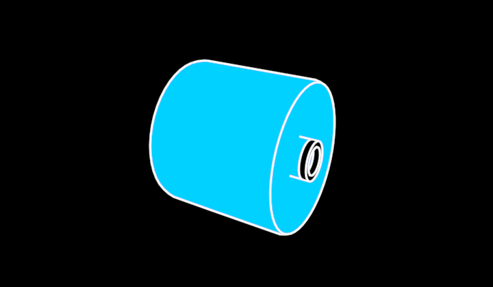

# FilmReel



A reel of film, platonic — the semi-finished product: a big roll wound on
a core, lying on its side. The roll is a thick-walled ring turned on a
lathe (one closed `mesh` solid) with its rims softened by a 45° chamfer —
film wound tight never has a sharp edge — and its hole showing; the
cardboard core stands proud of both faces as two short tubes. The mantle's
contours are smooth-surface contour generators solved for the camera, the
faces' rims and the chamfers creases: turn the view and the outline slides
round the roll.

```ts
reel = new FilmReel({ observer: this.observer, material: BLUE, width: 120 })
```

**Promoted params**: `material` (the film's colour — its category),
`diameter` (200), `width` (190, the film's width along the axis), `body`
(the core's fill), plus the Stroke set. Axis along x, up +y, origin at the
centre. Meshes are built once per shape and shared by every reel of it.

**Why it exists**: the grain of knowledge (`vocabulary/Grain`) — a dot in
the flow from extrusion to conversion becomes a reel. `/demo/?scene=materials`.
