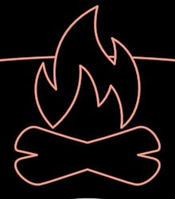

# Fire

The campfire: a flame over two crossed logs, red ink on a black body.

**The concept.** The hearth people gather round. "We would meet around the
campfire to freely exchange our knowledge" (InterBrain film, 19:38). It burns
at the heart of every SandTalk and on every edge of the ancient Tribe
(f5941, f6091, f8656), and returns as the "digital campfire" of the video
call (32:51).

**The drawing is Keynote's, read once.** The film's flame is Keynote's
built-in `Fire` icon grouped with a pair of crossed logs, the same group
PL02's deck carries as bezier paths (slide 7, the deck's own SandTalk:
`Fire_80` and the log outline grouped with it). `Fire.ts` reads both paths
from the generated deck module (`Slides/assets/pl02/slide07.ts`) rather than
copying numbers, and normalises them: centred on the group's box, `size` the
whole height, y up.

**Params**
- `size`: the whole height, flame tip to the logs' underside (width is
  `FIRE_ASPECT` ≈ 0.81 of it).
- `tint`: red (the film); the deck draws it white.
- `stroke`: pen width in screen px (2.2, the film's fine line).
- `opaque` 0..1: the black body under the ink (default 1), so the ring of
  conversation passes behind the fire as it does at f8656.

**Abilities**: Create lays the logs, then the flame rises from them.
`reach` is half the height, so a DreamNode or a sand slot can fit it.

**Residual**: the film's fire carries a soft red glow, which isn't drawn
here. The PL02 demo slides (`demo/pl02/Density01.ts`, `Mesh01.ts`, …) still
draw the icon through their slide data; they are slide reproductions, not
copies of this holon.

**Proven by** `test/ib-fire.test.ts`. Compare: `docs/reports/interbrain/fire-compare.png`.
