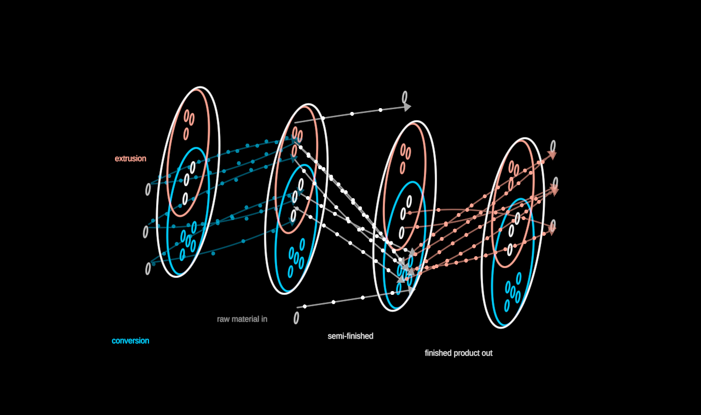

# FlowMap

An organisation's value flows as a visual automaton: a state machine whose
internal state is mirrored by its display state. The GROUP is one circle
holding its MEMBERS (subsidiaries, sites) as small rings; PARTNERS ring it
from outside — suppliers on the left where value enters, customers on the
right where it leaves, two-way partners above and below. Flows of value run
between them as channels with particles streaming down them.

Plain data in (`FlowMapData`): `categories`, `members` (with their
categories), `partners` (with a side), `stages` (the value chain, in order),
`flows` (from, to, stage, rate, certainty). The mock is generic.

**The degrees of freedom** — every one a param, smooth and reversible:

- `grain` 0 → 1 reveals the categorical dimension. Each category's disc
  shrinks in from the group's own circumference (the tangent point never
  moves); two categories land on the vesica piscis. Members glide into the
  region of exactly their categories and take its colour; members of
  several sit in the overlap, neutral. N categories, not two.
- `stage(id).shown` switches a flow layer on: its channels draw on and
  its particles start to run.
- `expand` 0 → 1 reveals the value chain's ORDER as a dimension: the map
  turns to the side (`tilt`) and dips into a 3/4 view (`pitch`) — the turn
  leading, the slices fanning out behind it — into a stack of identical
  slices, one per step, and
  each stage's flows run from its slice to the next. Inflow converges,
  outflow fans out. Collapsing lays it flat and face-on, exactly.
- `stage(id).open` opens or closes one gap of the stack — stages collapse
  individually but can never reorder.
- `time` (seconds; advance it linearly) runs the particles — a pure
  function of time, evenly spaced by arc length (`spacing`, divided by a
  flow's rate) at `speed` units per second: short channels carry few.
- `labels` — stage names under the stack, category names by their discs.
- Members of one region pack as a small honeycomb round the region's
  deepest point, so a region reads as a set, never a face.
- Create: the group circle draws, members ripple out from the centre,
  partners round the ring; channels draw from source to target as shown. States: `uncategorised`, `categorised`,
  `flat`, `staged`.

**Certainty** (`src/certainty.ts`, a core ability): a stage, flow, member
or partner declared conjectural in the data is drawn GHOSTED —
translucent, its particles hovering (`wobble`) rather than running a crisp
line; real data is solid. Strokes, fills, arrowheads, Text and the Cylinder
all honour it. Below full certainty the renderer adds a SUPERPOSITION
(`src/render/superposition.ts`): each uncertain stroke and fill carries a
cloud of breathing echoes a few pixels off — potentiality, many microstates
behind one macrostate — that crystallise onto it as certainty rises
(`stage("raw").certainty.to(1)` is the collapse the demo ends on).
- `memberLabels` (default 0) — each member's `label` as small text in its
  ring, tinted as the ring; shown flat, fading as the stack turns.
  `memberScale` shrinks the rings so more members fit a region (20 members,
  13 in one region, fit at scale 1; 0.8 gives them room).
- `rim` — the group circle's presence, so a morph can bring it in: the demo
  opens with the members' relations to the centre morphing (Morph's
  `MorphCurves`) into the group circle. Staged, a `legend` names the
  categories; a gap's flows fan apart at their middles. Certainty inherits down the tree as a product.

**Seams**: `slices[k].hull` (the group circle, a Circle), `flows[i].line`
(a Line), `flows[i].dots[j]` (filled Circles — the neutral `symbol` "dot";
a stage's `symbol` names what its particles will become) — ready for Morph
(lines → one circle, dot → truck).

Particles and labels face the camera however the stack turns (a carrier
cancels the stack's heading, its inner part the pitch). `?scene=flowmap`
walks it all. Best seen orthographic (the demo's observer).

**Over time** (`table.ts`): a plain table — `from, to, stage, period,
volume[, unit, item]`, as CSV (`parseCSV`) or JSON records (`toRows`) —
folds into flows with a volume SERIES per period (`flowTable`; unknown
entities refused, or added as partners with `autoPartners`). Then `period`
(continuous, scrubbable; an axis of the state space) drives each flow:
width and particle density follow its volume (particles thin out one by one
along a golden-ratio sequence, never sliding), a period with data is solid,
a period WITHOUT data is conjecture — ghosted at the flow's typical level —
and an explicit 0 is data that nothing moved: the flow draws nothing until
volume arrives. A small period axis and readout come with it.
`?scene=flowmap-time` runs a mock year.
