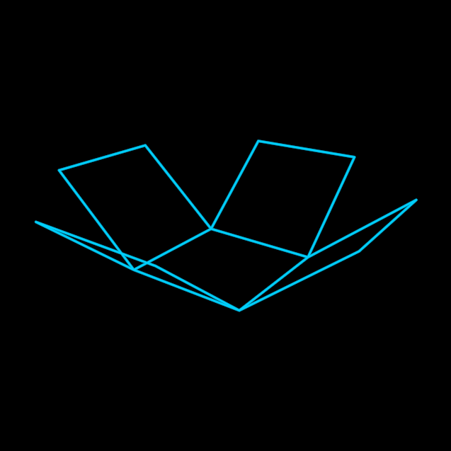

# FoldableCube

The narrative container of the TheWall holarchy: five square faces, an
open top, and one Bipolar degree of freedom. At fold 1 the wireframe
reads as a complete cube — the open cup whose missing top the trapped
mind doesn't see. At fold 0 it lies flat, the unfolded cross; at −1 the
walls fold through, wrapped around whatever the cube was pressed
against. The four side faces hang on pivot Groups sitting ON the bottom
face's edges, so the hinge line IS the shared edge — exactly the C4D
original's construction.

**Promoted params**: `size` (edge length), `fold` (−1…1), `taper`
(0…1, default 1), plus the Stroke set. The hinge law is exported once as
`hingeAngle(fold, taper = 1)` — shared with the XPBD tether's collision
cube (`src/geometry/xpbd.ts`).

**Taper — the film's depth.** The InterBrain film draws its cubes in
strong one-point perspective (back square 0.72 of the front, f5686,
f5821, f5221, f7021); a true cube from the far camera shows ≈ 0.9 and
reads as a doubled square. `taper` shrinks the bottom face to
taper·size and makes the walls trapezoids leaning out by just the angle
that closes them, so the cup becomes a right square frustum of the same
depth: seen front-on, the drawing's perspective cube; from elsewhere,
an honest solid. Corners still meet at fold ±1, lie flat at 0. At 1
everything is the cube above, point for point — no scene moved.
`taperFor(apparent, size, distance)` gives the taper that shows a
wanted back/front ratio from a camera that far. Used by `Narrative`.

**Lineage**: TheWall/DreamTalk `custom_objects.py:1452` (FoldableCube),
verified against MindVirus.mp4's jellyfish pulse frames. Proven by
`test/foldablecube.test.ts` (adjacent corners meet exactly at ±1).

**Parts**: primitives only — the bottom Rectangle and 4 wall Lines on 4 hinge Groups.
