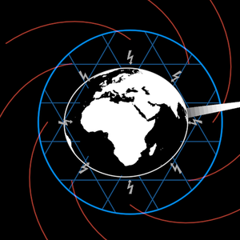

# FragmentedEarth



The planet under narrative warfare: the Earth inside a blue ring, a blue
triangular grid in the band between them, a ring of lightning bolts
striking in at the globe, and red field-lines spiralling outward past the
ring. In the InterBrain film it is the world the manipulated worldview
looks at (f3511, f3541, f4561 — vocabulary/Worldview `source: 1`) and the
domesticated eye's world (ch1, ch5); in the Web3 video it is the blue
(Web2) node of the yin-yang. Same symbol, so one holon: popped out of
`demo/web3/YinYang.ts`, which now imports it (`?scene=yinyang` renders
byte-identically before and after, at t 2.5 / 4 / 8 / 14).

```ts
const world = new FragmentedEarth({ radius: 375, globe: 0.59, limb: 1 })
world.seenFrom(observer)          // a scene whose camera is not the default
this.play(world.decoration.to(1)) // the band blooms round the bare globe
```

**Params**: `radius` (the blue ring's — the one size; every part is a
share of it, live), `globe` (the globe's share of the ring; Web3 0.46, the
InterBrain film 0.59), `spin` / `tilt` (the Earth's h and p), `limb` (the
globe's white silhouette — the InterBrain film draws every globe with one;
0 keeps the Web3 look), `boltLength` (share of the ring; Web3 0.24, the
film's smaller 0.155) and `boltTint` (Web3 white, the film's grey).

**State**: `decoration` 0..1 — the bare Earth (0) to the fragmented one
(1): grid and ring with it, the field-lines from 0.2, the bolts from 0.3
(the yin-yang's `divide` beat).

**Composes**: vocabulary/Earth (set on the page with `Recede`),
vocabulary/Conflict (the bolts, a ring of eight striking inward).

**Proven by**: `test/ib-worldview.test.ts` ("FragmentedEarth"), the
pixel-identical `?scene=yinyang`, and `?scene=ib-worldview` (f3541,
f4561; `docs/reports/interbrain/worldview-compare.png`).
