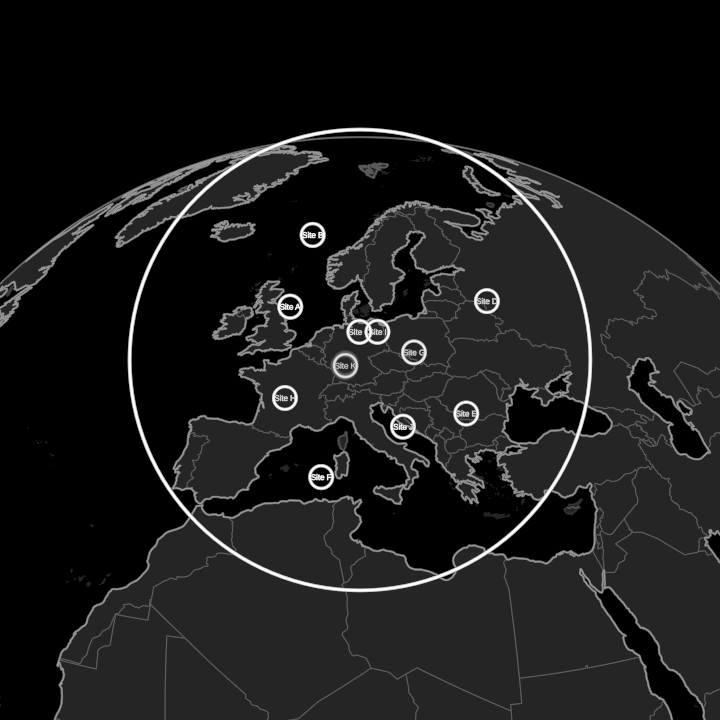

# GeoFlow



An organisation where it is and as what it is, with one param between the two. Any FlowMap whose members and partners carry a lat/lon lives on the Earth at `view` 0 and is the abstract FlowMap at `view` 1.

**At the globe:**
- The group's own place is a Headquarters, each geolocated member is a Factory, and each geolocated partner is a ring on the ground.
- Every member reports home along a great-circle arc.
- The data's flows run between their places as traffic: the Earth's particle Connections, one per flow, with volume set by rate and colour by stage.

**Between, the same transition both ways:**
1. The eye pulls back.
2. The arcs morph (MorphCurves) into one circle, the group, and the map's own rim takes over from it.
3. Each member lifts off its place as a ring and glides to its seat, starting from where its site is seen on the abstract plane.
4. The planet dims, its buildings sink, and the globe's traffic hands over to the map's own flows.
5. The planet goes, and the partners appear round the group.

`?scene=geoflow` (mock data). In free play, **v** walks globe ↔ abstract.

## API

```ts
geo = new GeoFlow({ data: myFlowMapData, geo: { group, region, places }, seenBy: () => this.observer })
// a song's beats: landIn, descent (→ geo.regionZoom()), rise, relate, traffic, then view; time is the clock
this.play(geo.view.to(1, { easing: "linear" }), 6.6)
```

`geo.places` maps member and partner ids to `{ lat, lon, certainty? }`. Any id may be missing; it then has no place and simply draws in with the map. A place given `certainty < 1` is a guess, ghosted on the way to its seat until it is seated. GeoFlow flies the scene's camera (EarthView + `followEarth`, with the lens set to `fov`), so give it the observer and animate GeoFlow, not the camera. It exposes `earth`, `eye`, `map`, `sites`, `links`, `traffics`, `relations` and `travelers` for a song that wants to reach further (`geo.map.grain`, `geo.map.stage("semi").shown`, …).

The technique was proved by a private DreamSong and consolidated here as a generic piece: nothing of that song's data travels with it. The mock geography (`mockGeo.ts`) places FlowMap's own mock organisation across Europe.
