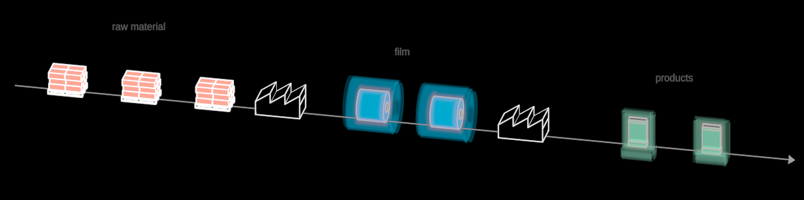

# Grain



A particle that knows how much we know about it — **the grain of
knowledge**. If all we know is kilograms moving, it is a neutral dot ("a
sphere is very neutral"). When the categories are told apart, the dot takes
its category's colour. When the type is known, the dot becomes a symbol of
an example of that material — a pallet of granulate, a reel of film, a
pouch. When the exact item is known, it is still that symbol, and named.
The rungs MORPH into each other, so the eye stays on the essence: this dot
stands for this more complex thing.

| rung | `grain` | what is known | what is drawn |
|---|---|---|---|
| mass | 0 | kilograms moving | a neutral dot (`NEUTRAL`) |
| category | 1 | its kind | the dot in its category's colour |
| type | 2 | its type | the type's symbol (a `SolidDrawing`), `material` = the category's colour |
| item | 3 | the exact item | the symbol, its label written in under it |

`grain` is continuous: 0.5 is a dot halfway to its colour; 1 → 2 is Morph's
three channels (`morphPhases`): the dot's fill goes, its outline flies apart
onto the symbol's visible 3D edges (`planMorph` / `blendPlan`,
src/geometry/correspond.ts), the symbol's fill comes in; 2 → 3 writes the
label. Every channel is continuous in `grain`, so a rung can be scrubbed,
reversed, or held halfway.

**Each rung has its own certainty.** `massKnown`, `categoryKnown`,
`typeKnown`, `itemKnown` (1 = the data says so, 0 = a picture we are
painting) — and the Grain's `certainty` (src/certainty.ts) FOLLOWS the rung
it stands on, piecewise linearly between them (`rungCertainty`). So the
renderer ghosts what is mocked and draws solid what is data, rung by rung:
a pallet guessed from mock data is a ghost (with its superposition cloud),
and `typeKnown.to(1)` is the collapse when the data arrives.

```ts
import { Grain, RUNG } from "../../vocabulary/Grain/Grain"

grain = new Grain({
  observer: this.observer,
  category: BLUE,                          // rung 1
  symbol: (o) => new FilmReel(o),          // rung 2 (gets observer, size, fades)
  label: "BOPP film · 2,400 m",            // rung 3
  typeKnown: 0.25,                         // the type is a guess so far
  stand: true,                             // the symbol stands on the dot's plane
})
this.play(grain.grain.to(RUNG.type), 3)    // dot → reel, ghosted
this.play(grain.typeKnown.to(1), 1.4)      // the data arrives: solid
```

**As a flow's particle**: `Stream`'s `symbol` hook takes it directly —
`new Stream({ path, symbol: (o, j) => new Grain({ ...o, observer, … }) })` —
and the Stream places and fades it. (FlowMap's particles are next; see
OPEN-THREADS.)

**Params**: `grain` (0…3), `radius` (the dot), `size` (the symbol's largest
extent), the four `…Known`, `certainty` (read-only: it follows them), plus
the Stroke set (`tint` is the symbol's lines). **Options**: `observer`,
`category`, `symbol`, `label`, `neutral`, `stand`. **Exports**: `RUNG`,
`NEUTRAL`, `grainPhases(g)` and `rungCertainty(g, known)` (pure).

**Why its own frame**: the morph is planned in the Grain's local space, not
world space, so a particle travelling down a flow does not re-plan it as it
moves — under an orthographic camera never (the plan is keyed on the view
direction and the symbol), in perspective only as its view turns. The dot
and the label face the camera from the observer's phi/theta, so a Grain
under a ROTATED parent wants a facing carrier (as FlowMap's particles have).

**Material symbols** it was made with: `Pallet`, `FilmReel`, `Pouch`,
`SheetStack` (each its own folder); any `SolidDrawing` works — a `Truck`
too. A symbol with a `material` param takes the category's colour.

Scene: `/demo/?scene=grain` — a flexible-packaging value chain, generic:
raw material in, extruded to film, converted to pouches. Dots → colours →
symbols ghosted from mock data → collapsed to solid flow by flow → named →
and back to dots. `/demo/?scene=materials` turns the symbols on a shelf.
Proven by `test/grain.test.ts`.

**Not yet**: the item rung is a label only (an item could also adjust its
symbol — a reel's width, an octabin instead of sacks); the superposition
cloud on a ghosted symbol's FILLS is heavy at symbol size (render/
superposition.ts: CLOUD_PX — David's eye); a Grain does not yet ride
FlowMap's channels.
