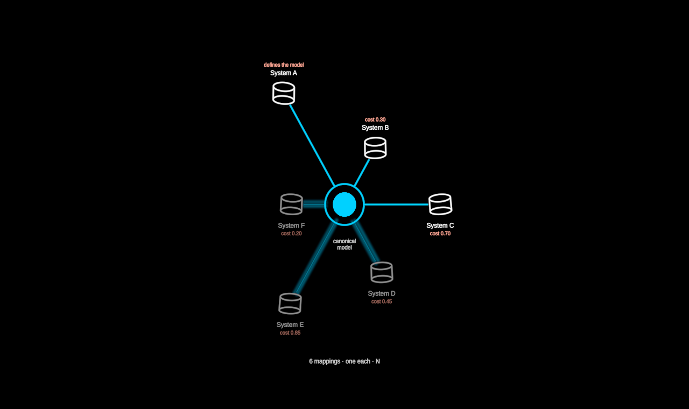

# Harmonization

Hub vs pairwise: how N source systems are made to speak one language.
The systems — databases, the founding `Cylinder` tilted so its caps show —
stand on a regular polygon. **Pairwise**, every pair is mapped directly:
the complete graph, N(N−1)/2 red chords, growing as N². **Hub**, one
canonical model stands at the centre and each system is mapped once: N
blue spokes. A spoke's length is its cost — in the hub picture each system
sits at the radius its distance to the model demands, on the same regular
angles, so the figure stays radially symmetric (a radar of distances).

The transition is one param. Each chord a–b bends through the centre
until it lies along two spokes; the systems move in to their cost radii;
the red web hands over to the blue spokes — the N² mappings collapse into
N. Onboarding is ordered: the **first** system defines the model (the hub
crystallises out of it as its spoke arrives, so it costs the whole
reach), every next system costs its own distance. A system not yet
onboarded is drawn in the certainty language — a ghost, its spoke a plan
still to be built.

Plain data in (`HarmonizationData`: `systems` with `id`, `label`,
`distance` ∈ [0, 1] to the canonical model, optional `certainty` for a
system we only suppose; `model`, the centre's name). The mock is generic:
"System A…F". Layout is pure (`src/geometry/harmonization.ts`): ring
phase (straight down is never a vertex — the hub's caption sits in that
gap), pairs, costs, cost radii, the bending chord.

**Degrees of freedom** (params; `stateSpace()` makes them walkable):

- `topology` 0 → 1 — `pairwise · hub` (key `t`; click a chord or the hub).
- `onboarded` 0 … N — `none · first · half · all` (key `o`; walkable in
  the hub picture; click a database). Between two positions the next spoke
  is drawing.
- `costs` — `hidden · shown`: each system's cost under its name (key `k`).
- `labels`, `radius`.

`?scene=harmonization` walks it: the systems and the web between them
draw on; the web collapses into a hub, a plan of ghosts; the costs are
written; the first system defines the model, then the others are
onboarded one at a time. `&play=free` to walk it yourself.
