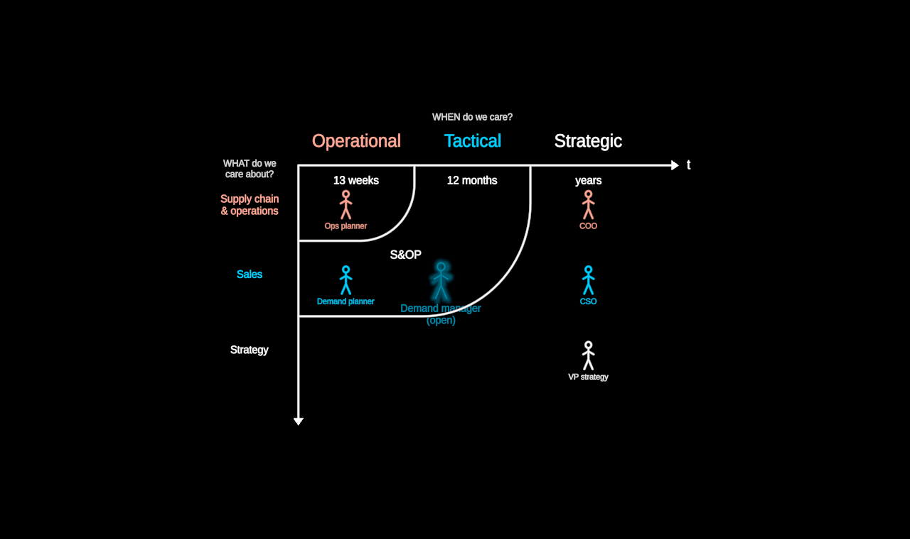

# Horizons

WHEN do we care, about WHAT, and WHO cares. Time runs right (t); "what do
we care about" runs down through the domains (supply chain & operations,
sales, strategy). The planning horizons nest from the corner where the axes
meet — OPERATIONAL (13 weeks) reaches operations only; TACTICAL (12 months)
reaches operations and sales, with S&OP at its edge; STRATEGIC (years) is
open. People stand in their cells (the shared `Figure`); a seat nobody
holds is drawn in the certainty language — a ghost, a superposition of who
it might be, which crystallises when it is filled.

Plain data in (`HorizonsData`: `horizons` with span/width/reach,
`domains`, `roles` with horizon/domain/certainty/vacancy, `notes`); the
mock's roles are titles, never people. Layout is pure
(`src/geometry/horizons.ts`): a role's cell is its horizon's region minus
the inner regions on its row; the open horizon keeps its own column.

**Degrees of freedom** (params; `stateSpace()` makes them walkable):

- `reveal` 0 … H — horizons appear inner to outer; regions draw on, names
  fade in, people step in.
- `role(id).emphasis` — one person brought forward.
- `role(id).certainty` — an open seat (`vacancy` "(open)" shown while
  uncertain) fills and crystallises.
- `labels`, `column`, `row`.

`?scene=horizons` walks it: axes, the three horizons one by one, a planner
forward, the open seat filled.
