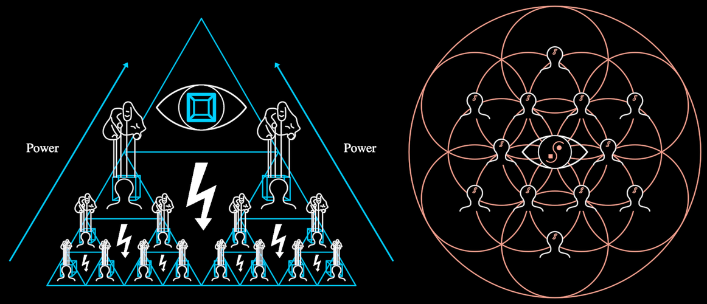

# HyperAgent



The collective agent that many minds become, in one holon with one number
between its two poles. On the left the **War Machine**: domesticated minds
in triangles, built by divide and conquer level on level, bolts between
them, the puppeteer's hands holding each pair from above, the domesticated
eye at the apex and "Power" climbing both flanks. On the right the
**hyper-agent of love**: the same minds, liminal, in a flower of life of
circles around the liminal eye.

**The concept.** "The divided and conquered divide and conquer" (12:43):
fragmentation organises itself recursively until "all agents of
fragmentation self-organize into a war machine, a collective hyper-agent
rooted in fear and in service to war" (13:59–14:12), with "the spirit of
fragmentation" (13:38), the domesticated eye, above every level. At the end
of the film the same structure turns: "a collective hyper-agent grounded in
love … that knows no enemies" (42:26–42:36). The film morphs the pyramid
into the flower (f13006 → f13111), and so does `love`.

**The construction.** A level-k unit of side s is the Sierpinski split of
its triangle. The top half-triangle holds one mind (at the root, the eye),
the two lower ones hold level-(k−1) units, the inverted middle holds the
bolt, and two hands stand at the top half's lower corners holding the head
mind of each lower unit by strings to its cube. A level-0 unit is one mind.
Every triangle drawn is a Mind's own frame (David's 2024
`MolochConsciousness`) or the eye's, so their union is the pyramid. Depth 3
gives the film's 14 minds under the eye (f4351). Depth 0 is the small icon,
the eye in its triangle, "War Machine" (f2506, f2566).

**The love walk**, in two halves:
- **0 → ½, in place.** The bolts, hands and flanks fade. Every triangle
  rounds into its circle and every mind turns liminal (Mind's own
  `liminal`). The eye's cube gives way to the Vision (MolochEye's `iris`),
  and its triangle rounds too (f13051, f13066).
- **½ → 1, the gathering.** The minds leave the pyramid for the hexagonal
  lattice round the eye, all one size, each to its nearest free spot. Each
  mind's circle hands over to a flower circle that grows to the lattice's
  spacing. The eye's frame becomes the centre circle, and the rim closes
  round them (f13096, f13111). Only whole lattice shells are used (6, 12,
  18, 30 …). A mind beyond them (two at depth 3, which the film also drops
  from 14 to 12) is gathered into the eye.

```ts
war  = new HyperAgent({ size: 1437, depth: 3 })            // f4351
unit = new HyperAgent({ size: 1062, depth: 1, apex: 0 })   // f3676
icon = new HyperAgent({ size: 250, depth: 0, power: 0 })   // f2506
love = new HyperAgent({ size: 1437, depth: 3, love: 1 })   // f13111
```

**Params**
- `size`: s, the pyramid's side. The origin is the pyramid's mid-height,
  which is also the flower's centre. Everything else derives from s,
  measured off f4351, f3676 and f13111 (see the header of `HyperAgent.ts`):
  bolt 0.22 of its unit's side, hand 0.135 of it, the eye's half-height
  0.145 of its triangle's side, lattice spacing 0.178·s, eye in the flower
  0.054·s, busts in the flower 0.48 of the spacing.
- `depth` (3): the recursion. It is structural (fixed at compose), on the
  symbolic/CPU side.
- `love` 0..1: war machine to hyper-agent of love. One number that scrubs.
- `power` 0..1: the "Power" arrows up both flanks (war only).
- `apex` 0..1: the eye at the apex (1) or a mind there (0, the bare divide
  and conquer of f3661–f3781). Whether the crown mind joins the flower is
  read at compose (it does when `apex` < ½).
- `build` 0..1: the recursive growth, leaves first, then level by level the
  bolt strikes, the head mind arrives and the hands take hold. Create walks
  it 0 → 1 while drawing each unit in its window.
- `stroke` (2.2 px), `rim` (the flower's rim on or off).

**Abilities**: walkable (`stateSpace`), with a `love` axis (war ↔ love) and
an `apex` axis (mind ↔ eye). The inner symbols are posed by the whole
(their params are bound), so they are not walkable on their own. Create is
the recursive build.

**Composed, never redrawn**: `Mind` (with its triangle and circle frame),
`MolochEye` (`iris`), `Conflict`, `Puppeteer`, and Mind's `frameOutline`
for the eye's frame. Only the flower's circles and the flanks belong to the
HyperAgent.

**Residuals**
- The film's love state has a fine flower-of-life texture inside the rim
  and soft black halos behind each mind and the eye, which hide the circles'
  lines. Ours has the circles and the minds' black busts, but no texture and
  no halos. Lines still cross the eye's lens.
- Mid-walk (f13066) the film's circles are about the triangles'
  circumcircles (0.58 of the side). Mind's liminal circle is 0.5 of the
  side, so ours are tangent where the film's overlap.
- The film rebuilds the camera as the recursion grows (each step fills the
  frame, f3616 → f3871). Ours builds in place at the final size.
- The Mind's cube reads as a deep box off-centre, which is Mind's own
  residual.
- RED and BLUE are the palette's, a little lighter than the film's.

**Proven by** `test/ib-hyperagent.test.ts`: the counts per depth; the
triangles and middles tiling the pyramid exactly; hands at the held minds'
apexes with strings to their cubes; composition from the shared symbols;
the lattice shells and the one-to-one assignment; both endpoints of `love`
and its two halves; the build's windows; the eye's frame as Mind's
triangle. Standalone scenes in `demo/interbrain/HyperAgentDemo.ts`:
`ib-hyperagent` (the build by recursion, Power, then the walk to love) and
`ib-hyperagent-unit` (the depth-1 unit, f3676). Comparison against f3676,
f4351, f13066 and f13111: `docs/reports/interbrain/hyperagent-compare.png`.
