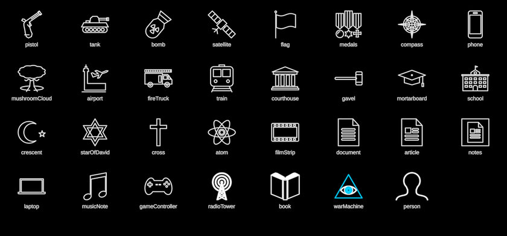

# Icons (an invisible asset)



The InterBrain film's PROPS: the small line icons that dress a diagram
without carrying a concept the narration names. Not sovereign (no
`static sovereign`, like Sketch and Slides), so they never appear in the
vocabulary bar. An icon that comes to carry a named concept graduates into
its own holon, as `RadioTower` (broadcast) and `Book` (the written word) did.

```ts
import { icon } from "../Icons/Icons"
icon("tank", { size: 60, tint: BLUE, x, y })   // any name, as a holon
```

**The table**
- Keynote's own paths, read from PL02's deck: `laptop` (Notebook_109),
  `musicNote` (Music Note_217), `gameController` (Game Controller_92).
- Drawn off the frames as minimal line-art: the arms race and the
  generations of warfare (f931, f2746–f2836): `pistol` (the flintlock),
  `tank`, `bomb`, `satellite`, `flag`, `medals`, `compass`, `phone`; the
  psy-war (f2986): `mushroomCloud`; the rows over the spheres (f2161):
  `airport`, `fireTruck`, `train`, `courthouse`, `gavel`, `mortarboard`,
  `school`, `crescent`, `starOfDavid`, `cross`, `atom`; the media round the
  GitRepo (f8971): `filmStrip`; the Vault's pages (f8326): `document`,
  `article`; and `notes`, a page in a blue square, the neutral face where the
  film shows a second-brain app's mark (f7726, f8131; drawn as f8536 shows
  "Second Brain").
- Composed, never redrawn: `radioTower` (RadioTower), `book` (Book),
  `warMachine` (HyperAgent at depth 0, the eye in its triangle), `person`
  (Figure's bust).

The film's arms race has exactly flintlock, tank, radio tower, bomb,
satellite, phone + laptop: no spear, catapult, cannon or drone appears in
its frames, so none is drawn. Third-party marks (the app icon, the logos on
the film's phone and laptop screens) are not redrawn; the screens are blank.

**Icon params**: `size` (the larger side), `tint`, `stroke` (1.6 px),
`opaque` (a black body under closed outlines), `presence` (fades it all).

**Proven by** `test/ib-icons.test.ts` (every icon centred, larger side =
`size`; Keynote icons point for point; composed entries are their holons).
Contact sheet `ib-icons`; comparison `docs/reports/interbrain/icons-compare.png`.
