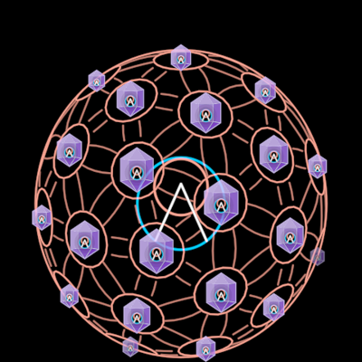
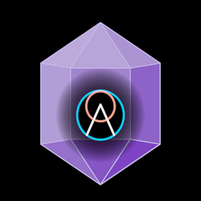

# InterBrain

David's InterBrain symbol (2026-10-18): "the flower-of-life sphere
arrangement with the obsidian crystals and the Project Liminality logo
inside". It's the red geodesic flower of life with a gem in every node and
the [Logo](../Logo/) at its heart. Folded inside it is what it holds: the
symbol **unfolds into the UI**
([VISION-HYPEROBJECT](../../../docs/VISION-HYPEROBJECT.md)).

**The concept.** "A collectively interconnected inter-brain in which we all
participate as equals" (27:07), "a collective knowledge garden" (39:27). The
same sphere appears in the film (f11896, f11941, f12796, f13201), in the
teaser (2025-05-12, 0:33–0:38: the blue narrative lattice with a crystal
boxed in each node turns into the red flower of life), and in the 2025 C4D
work (`DreamTalkVocabulary/FlowerOfLife/FlowerOfLifeSphere`).

**One implementation.** The sphere is the [Noosphere](../Noosphere/) in its
InterBrain state (`bloom 1, garden 1, interbrain 1`, ν 2 as in f11941). It is
imported, and its states are held there, so its own axes stand down. The gems
are `InterBrainGem`, a part of this DreamNode (below). The heart is a
[DreamNode](../DreamNode/) holding the Logo, with its ring hidden while the
symbol is folded.

## The unfold: `unfold` 0..1 (walkable: `u`, or click the symbol)

Clicking the symbol is a transition into what it holds, not a zoom and fade.

| unfold | what happens |
|---|---|
| 0 → 0.3 | each gem facing you releases a DreamNode: a ring draws round the gem |
| 0.15 → 0.75 | the nodes fly out to a liminal web round the heart: friends (dreamers, red) and dreams (blue), alternating. The layout is [LiminalWeb](../LiminalWeb/)'s `webLayout`. The heart's ring draws on and grows into the web's centre, and the sphere swells and fades behind it |
| 0.65 → 1 | the song's chapters arrive as a [SongLine](../SongLine/) beside the web: the DreamSong that *is* using the InterBrain |

A song is one path through this axis. Free play is every other path.

Faces: `?scene=ib-interbrain` (the symbol; add `&play=free` and press `u`)
and `?scene=ib-interbrain-unfold` (the unfold played, then folded back).
Proof: `docs/reports/interbrain/interbrain-unfold.png`.

## Params

- `radius` is the sphere's radius. It is the one size, and the `reach`.
- `frequency` (ν, set at construction) defaults to 2.
- `heart` is the Logo's ring as a share of R: 0.3, chosen because no frame
  shows the Logo in the sphere. 0 hides it.
- `chapters` is the number of clips in the song line (8, set at
  construction).
- `unfold` is the state.

Layout constants are in `INTERBRAIN` (`web` is the centre ring unfolded, plus
the `song` line's size and place). The phases are `RELEASE`, `FLY0`/`FLY1`
and `SONG0`. What it holds is `held()`: the heart plus three friends
(`DREAMER_FACES` 1–3) and three dreams (the DreamTalk symbol, the Vision,
the liminal Mind).

Create: the sphere draws on from the top, then the Logo makes itself at its
heart.

## InterBrainGem (`InterBrainGem.ts`)

The gem that studs the symbol is also the InterBrain's small icon, which the
film rings as a DreamNode (f8221, f12376 red; f9271 blue). It is the Logo at
the heart of a faceted crystal, with a dark bloom round the Logo. The
composition is David's (InterBrain.png, 2025-04-06). The crystal is **our own
construction**: a double-terminated hexagonal quartz seen face-on, nine
facets washed purple and lit from the upper left.

The reference crystal is **exactly Obsidian's logo**. InterBrain.png's alpha
silhouette and obsidian.md's `obsidian-logo-gradient.svg`, rendered at the
same size, overlap at IoU 0.996 (both have a 0.776 aspect; mirrored, they
overlap at 0.89). The teaser's and the film's studs are that gem in 3D.

Params: `radius` (the crystal's half-height H, and its `reach`), `tint`,
`shadowTint` → `lightTint`, `stroke`, `edgeOpacity`, `facetOpacity`,
`bloomOpacity`, `bloomRings`, `bloomReach`, `logoStroke`. Measured on
InterBrain.png: half-width 0.777·H, Logo ring 0.304·H, 0.142·H below the
centre (`CRYSTAL`). Face: `?scene=ib-interbrain-gem`.

## Proven by

`test/ib-interbrain.test.ts`, `docs/reports/interbrain/interbrain-symbol-compare.png`
(f11941, the teaser and InterBrain.png against the render),
`docs/reports/interbrain/interbrain-unfold.png`, and
`docs/reports/interbrain/interbrain-compare.png` (the gem).
