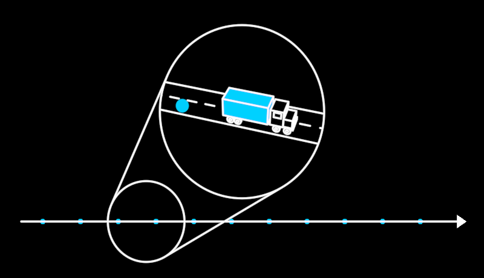

# Lens



A circle lying on the scene that lifts toward the camera and becomes a
magnifying glass — **magnification by proximity**. Its far face stays
where it was; its near face rises along `liftX/Y/Z` and is exactly the
same size in the world, so it is bigger on screen only because it is
closer. Nothing is scaled: the perspective IS the magnification. Between
the faces stand the two contour lines of the oblique cylinder they bound,
solved for the camera every frame. The near face is filled black — it is
a window, and what lies behind it is hidden.

```ts
lens = new Lens({ observer: this.observer, x: -330, y: -230, radius: 130 })
this.play(lens.lift.to(1), 2.4)
```

**Params**: `radius`, `lift` (0 lying down → 1 lifted), `liftX/liftY/liftZ`
(where the near face's centre goes, lens-local), plus the Stroke set.
`inside(worldPoint)` — is that point SEEN within the near face? — is what
anything shown through the lens trims itself to (`Road`'s `bound`);
`insideKey()` says when its answer can change.

## FlowLens — the abstract made concrete

David's board (2026-10-13, top right): a thin arrow with a steady stream
of blue dots, a lens on it, and in the lens, trucks on a road. Noosphere →
biosphere.

```ts
stream = new Stream({ path, count: 12, spacing: 130, speed: 70 })
lens = new FlowLens(this.stream, { observer: this.observer, x: -330, y: -230, radius: 132 })
…
this.play(lens.lift.to(1), 2.4)       // the near face carries a copy of the flow up: line and dots, magnified
this.play(lens.concrete.to(1), 3)     // the line becomes a Road, each dot a Truck — the flow keeps running
this.play(lens.concrete.to(0), 3)     // and back
```

Lifted, the near face shows the flow under the far face — a copy carried up,
so at first it is just the same line and dots, closer. `concrete` 0 → 1
then morphs the line into a `Road` (MorphCurves: line → edges and dashes)
on a ground plane through the near face (`tilt`, `heading`), and every dot
inside the window into a `Truck`. Dots ARRIVE at the rim as dots, become
trucks across the middle, and LEAVE as dots: the flow is continuous, never
paused, and no truck crosses the rim. Each particle's morph is driven by
`morphPhases` (Morph's verb as a function of one completion): its fill goes,
its outline flies to the truck's visible 3D edges, the truck's fill comes.
Paint order is occlusion order — the road, then the trucks' solid fills
over it, then the outlines.

**The flow source** is any `{ path(), particles(), frame? }`: the path in
`frame`'s local space, and each particle's place along it as a fraction of
arc length (−1 hidden). `Stream` answers it; so does FlowMap's `Flow`
(`frame` = the map's stack). **Options**: `slots` (particles the window
holds at once, default 4), `dotRadius`, `dotTint`, `lineTint`,
`concreteSymbol` (default a Truck), `symbolHalfHeight`. **Params**:
`concrete`, `tilt`, `heading`, `symbolScale`.

Scene: `/demo/?scene=lens`. Proven by `test/lens.test.ts`.

**Certainty**: a source may say how sure its data is (`certainty()`, read live — FlowMap: stage × flow). What the lens shows of the flow (line, dots, road, trucks) is a `FlowContent` carrying it, so a conjectural flow is ghosted inside a crisp lens.

**Not yet**: the concrete world is one road through the window's centre (a
curved road, two directions, a landscape); while a particle is
mid-morph its correspondence is re-planned every frame (fine offline,
heavy for realtime with many slots); the lens is flat-on to a flat flow —
a flow on a tilted FlowMap stack works through `frame`, but the window's
ground is not yet aligned to it.
