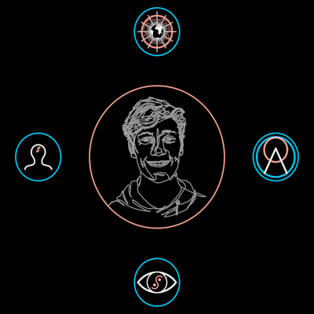

# LiminalWeb

One DreamNode at the centre, every node it is related to on a ring around
it — and the focus moving from node to node.

**The concept.** "Your dream garden will self-organize over time into your
unique liminal web, connecting each dream to the dreamers you share it
with, and each fellow dreamer with the dreams you share. Said differently,
a story becomes a place where you can meet your peers, and for each peer
you see all the stories that mediate your relationship" (32:01). No
category is imposed: what stands round the centre is only what is tied to
it.

**Face**: `?scene=ib-liminalweb` t≈14 (f9721, David with his four). The demo
walks the film's tour: the Logo with its dreamers (f9646), a friend with her
six dreams (f9676), the liminal eye with its four dreamers (f9691), David.

## Construction

Measured on f9721/f9676: centre ring 137.5 px, satellites 46 px
(`WEB.satellite` = 0.335 of the centre), orbit 242 px (`WEB.orbit` = 1.76).
Satellites start at the top and go clockwise; nodes not tied to the centre
wait `WEB.away` orbits out on their own bearing, faded and folded to nothing.

## Params

`radius` (the centre ring), `orbit`, `satellite`, `nodeStroke`, and
**`focus`** — ONE number, an index into `tour`; at a whole number the layout
is that stop's (`webLayout`, a pure function), between stops every node's
place, size and presence blend, so a focus change scrubs. Walkable as the
`focus` axis (`w`), one position per stop, named for its centre.

Construction data: `relations: { nodes: WebNode[], ties: [dream, dreamer][] }`
(`neighbours(g, i)` reads a tie either way) and `tour: number[]`. Defaults:
`FILM_WEB`, `FILM_TOUR`.

## Proven by

`test/ib-liminalweb.test.ts` (ties both ways, the film's ring sizes, layout,
measured proportions, focus stops = layouts and blends between, axis);
`docs/reports/interbrain/liminalweb-compare.png` (f9646, f9676, f9691,
f9721 against the render).
