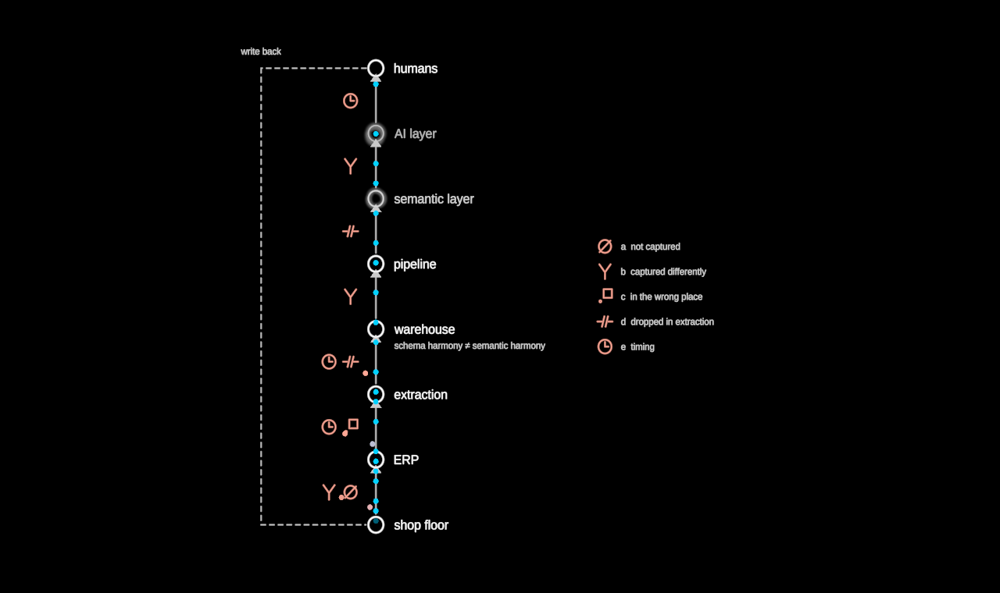

# LossyChain

The lossy chain: information rises from the ground truth to the humans who
decide, through a vertical chain of stages — and every arrow is a lossy
projection. The stages stand at equal spacing on one axis, each a quiet
circle with its name; a stream of particles rises through them
continuously. At each arrow some particles leave the stream and are taken
in by the small red glyph that names how they were lost, so the stream
visibly thins on its way up. Shown or hidden, the same chain: hidden, it
looks lossless.

The five kinds of loss (`LossKind`), one glyph each:

- **a** `notCaptured` — a slashed circle: never recorded.
- **b** `capturedDifferently` — a fork: one fact, two meanings.
- **c** `wrongPlace` — a square shifted off its point: recorded elsewhere.
- **d** `droppedInExtraction` — a cut line: lost between systems.
- **e** `timing` — a clock: true, but not in time.

A note sits at one stage (by default the warehouse): *schema harmony ≠
semantic harmony*. A stage that is a known unknown (`certainty` < 1) is drawn
ghosted, in the certainty language. Beside the chain, the **write path** runs
back down — decisions returning to where the work happens. Mostly unbuilt: a
dashed outline. Built, it draws on solid, crystallises and flows.

Loss is deterministic, never random: particle *j* carries a fixed
golden-ratio seed, an arrow with *c* losses takes `c · rate` of what reaches
it (`arrowDrops`, `lossFate` — pure, tested), so the same particles fall at
the same arrows every cycle.

**Data** (`LossyChainData`, generic mock by default): `stages:
{id, label, certainty?}[]` bottom to top; `losses: {at, kind}[]` (`at` = the
arrow from stage `at` up to `at + 1`); `note?: {at, text}`; `write?` (the
write path's name).

**Degrees of freedom** (params; `stateSpace()` makes them walkable):

- `losses` hidden · shown (key `x`) — the glyphs, the legend, the peeling.
- `note` hidden · shown (key `n`).
- `write` unbuilt · built (key `w`) — the write path's certainty and flow.
- `time` — a clock; the stream keeps rising in free play.
- Create: the chain draws on from the ground up.
- Construction: `gap`, `node`, `spacing`, `speed`, `rate`.

`?scene=lossychain` walks it: the chain draws on, flows as if lossless, the
losses are shown, the note, and the write path is built.
