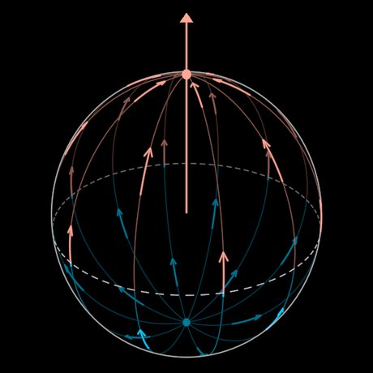

# MeaningSphere

The sphere of meaning: arrows leave the bottom pole, spread over the surface
to the equator, and gather again at the top pole. It joins two drawings into
one solid.

- **Diabolic → symbolic.** Arrows rise up both sides from the *diabolic*
  (thrown apart: parasitic virality) to the *symbolic* (thrown together:
  symbiotic communion).
- **Idolic → iconic.** A flat disk with arrows radiating outward is the
  *breadth of distribution*. One arrow rising from the disk's centre is the
  *depth of meaning*.

The disk is the sphere's equatorial plane, and the depth is its axis. An
idol spreads as wide as it can along the plane. An icon is few and deep, and
what spreads from it comes back together. The same two motions, diverging
from one pole and converging on the other, can be read as solve et coagula
or as differentiating and bringing together, polarised either way. The
symbol doesn't draw them any more literally than that.

## The states (both walkable, both 0..1)

- **`depth`**: idolic 0 … iconic 1. At 0 the sphere is flattened into its
  equatorial disk: breadth without depth. It has twice the meridians, and
  every arrow runs out from the centre and slides off the rim, so nothing
  returns. As the depth grows, the disk rises into the sphere. Every other
  meridian fades, the flow comes back together at the top, and the red
  axis of depth stands through the north pole.
- **`reading`**: rising 0 … giving 1. The arrows' direction is
  ambiguous, so the symbol holds both readings.
  - *Rising* (the drawing's own arrows): the diabolic spreads from below and
    the symbolic gathers above.
  - *Giving*: the symbolic pours out from above, so it nourishes. Every
    vector converges onto the diabolic below, so it extracts.

  Between the two readings the flow reverses along the meridians. Every
  arrow sweeps to the equator, shrinks to a point there and comes out turned
  round. On the disk, the giving reading is extraction: arrows come in from
  the rim and converge on the centre.

The player assigns keys (digits), and a weaving scene can rekey them.
`time` is a clock, so the flow runs in free play.

## The open middle

The equator (`metabolic`, 0 hides it) is drawn **dashed** because it is a
placeholder. It stands for a possible middle term, the diabolic metabolised
into the symbolic, and it isn't settled. Arrows are blue (cold) below it
and red (warm) above it, and they change colour as they cross.

## Params

- `radius` is the one size. `reach` is the axis's tip, 1.32 R.
- `meridians` (12) and `arrows` per meridian (3) are set at construction.
- `time` is the clock. `speed` is pole-to-pole lengths per second (0.07).
  `turn` is how fast the solid turns about its pole (rad/s of `time`).
- `spin` and `pitch` set the solid's own turn and its lean toward the eye.
  Leaned 0.42, the disk reads as the ellipse it is drawn as.
- `symbolicTint` (red), `diabolicTint` (blue) and `lineTint` (white) set the
  colours. `guideStroke`, `guideOpacity`, `arrowStroke` and `backOpacity`
  set the pens and the far side's brightness.

Construction numbers are in `MEANING`. The pure helpers are `radii(depth)`,
`meridianPoint(u, φ, a, b)` and `readAt(x, reading)`.

## Construction

The surface is an ellipsoid of revolution about the pole axis: equatorial
radius R, polar half-height R × depth (eased), which is a sphere at 1 and a
disk at 0. Everything lives in the solid's own frame, so an orbiting camera
sees real geometry. The near side is bright and the far side dim. The limb
is the eye's horizon on the ellipsoid, which is the sphere's horizon carried
over by the affine map between the two.

The arrows are a pure function of time, reading and depth. They are evenly
phased along each meridian and staggered on alternate meridians, so the
pattern is symmetric and never random. All lines of one tint and one side
share a single `Polylines` with per-loop opacity. The whole symbol is twelve
strokes and two pole discs, and it is cheap to redraw every frame.

Create: from the south pole the meridians spread to the equator and gather
at the north. Then the axis of depth rises and the arrows begin to run.

Face: `?scene=meaning-sphere` (add `&play=free` to walk it). Proven by
`test/meaning-sphere.test.ts`.
