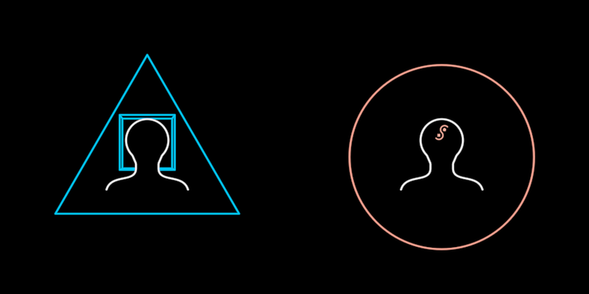

# Mind

A person's consciousness, in the two states the InterBrain film turns one
into the other. On the left the **domesticated** mind: the bust with a
blue cube around its head, standing in a blue triangle. On the right the
**liminal** mind: the cube gone, the red Vision in its head, a red circle
around it.

**The concept.** The domesticated mind is held inside a narrative: the
cube is "a mechanical narrative constructed for the purpose of
manipulation", and the triangle is what such minds are built into, the
divided and conquered dividing and conquering, the "captured minds" the
War Machine is made of (13:03). The liminal mind has let the cube go and
holds a living vision instead. These are the agents of wholeness the film
gathers into tribes, the InterBrain, and the hyper-agent grounded in love
(23:27, 42:30). The film turns one into the other at f7021 (the arrow) and
again at 2595–2630, where the war machine's minds become liminal.

**The states, named the way David named them in 2024:**

| `liminal` | `framed` | name |
|---|---|---|
| 0 | 0 | **DomesticatedMind** (David's 2024 DreamNode: bust + `FoldableCube(color=BLUE, bottom=False)`) |
| 0 | 1 | **MolochConsciousness** (David's 2024 DreamNode: DomesticatedMind + a blue triangle) |
| 1 | 0 | the **liminal** mind |
| 1 | 1 | the liminal mind in its red circle |

**Params**
- `size`: R, the liminal circle's radius. Everything else derives from
  it (measured off f7021): bust height 0.765·R, triangle circumradius
  1.15·R (side `triangleSide` = √3·1.15·R, for composers that tile minds).
- `liminal` 0..1: domesticated to liminal, one number that scrubs. The
  cube lifts and fades. The Vision fades in. The frame's outline slides
  ray by ray from the triangle onto the circle while its colour goes
  blue to red.
- `framed` 0..1: the frame's presence (default 1).
- `tint` (the person's ink, white) and `stroke` (2.2 px, the film's finer
  pen).

**Abilities**: walkable (`stateSpace`), with a `liminal` axis
(domesticated ↔ liminal) and a `framed` axis (unframed ↔ framed). Create
draws the person, closes the cube round the head and draws the frame on.

**Composed, never redrawn**: the person is `Figure` at `form: 1` (the
bust, THE person) with `opaque: 1`, so its black silhouette hides the
cube's back behind the head, as the film's does. The cube is
`FoldableCube` at fold 1, its open side to the viewer. The mark is
`Vision` (film band weight). Only the frame line belongs to the Mind.

**Residual**: the film's cube icon has a strong one-point perspective
(back square 0.71 of the front). A true box of head size seen by the
scene's camera from 1500 units shows only about 0.9, so our cube reads as
a doubled square rather than a deep box. A flared cup (fold < 1) doesn't
fix this, because it breaks the square into four flaps.

**Proven by** `test/ib-mind.test.ts` (an equilateral triangle at
`liminal` 0, a true circle at 1, the frame's halfway rays, attach order,
and the inner symbols posed rather than walkable). Standalone scene
`demo/interbrain/MindDemo.ts` (`ib-mind`). Comparison against f7021,
f1861 and the CRI PNGs: `docs/reports/interbrain/mind-compare.png`.
