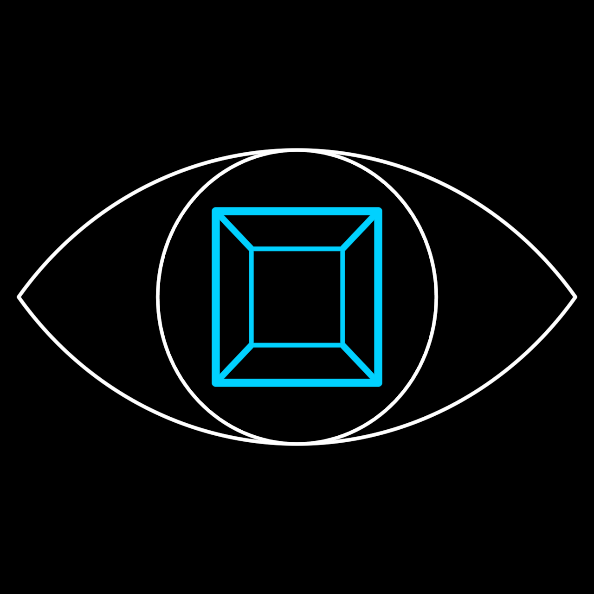

# MolochEye

The innermost symbol of the TheWall holarchy — the control mechanism's
gaze, rebuilt as a platonic construction. Pure lines plus exactly one
fill: the black disk that blots out whatever the eye sits on (the
sclera is transparent — on the black ground the symbol is only its
strokes). The construction's single unit is `height`, the lens
half-height; the lens arcs come from the 3-4-5 construction (each arc's
sine of half-span is 4/5) and the pupil cube's inner square from the
one-point-perspective factor k — never hard-coded.

**Promoted params**: `height` (the unit), `tint` (the pupil cube's
color — only the gaze is tinted), `iris` (0..1, what the iris holds),
plus the Stroke set.

**The iris** (`iris`): 0, the default, is the domesticated eye of the
InterBrain film — the blue cube, Narrative (f31, f12661). 1 is the
LIMINAL eye: the same lens and ring with the red `Vision` mark in the
iris, filling it (R = 0.98·h, measured on f12691). Between, the cube
shrinks and fades as the mark grows in (the film dissolves the cube into
particles — another holon's job). Standing alone the eye walks the state
axis `iris: cube ↔ vision`; as a quiet part of another symbol (MindVirus's
gaze) it builds no mark and yields its states to the whole.
`?scene=ib-eye`.

**Lineage**: the canonical face DreamTalkVocabulary/MolochEye/
MolochEye.png, measured at stroke centerlines; recipe in
docs/reports/wall-stack-study.md ("MolochEye — the platonic recipe").
Proven by the overlay PASS in docs/reports/wall/molocheye-final.png +
molocheye-report.json and `test/molocheye.test.ts`.

**Parts**: primitives only — Arcs, Circle, Square, filled Ellipse.
