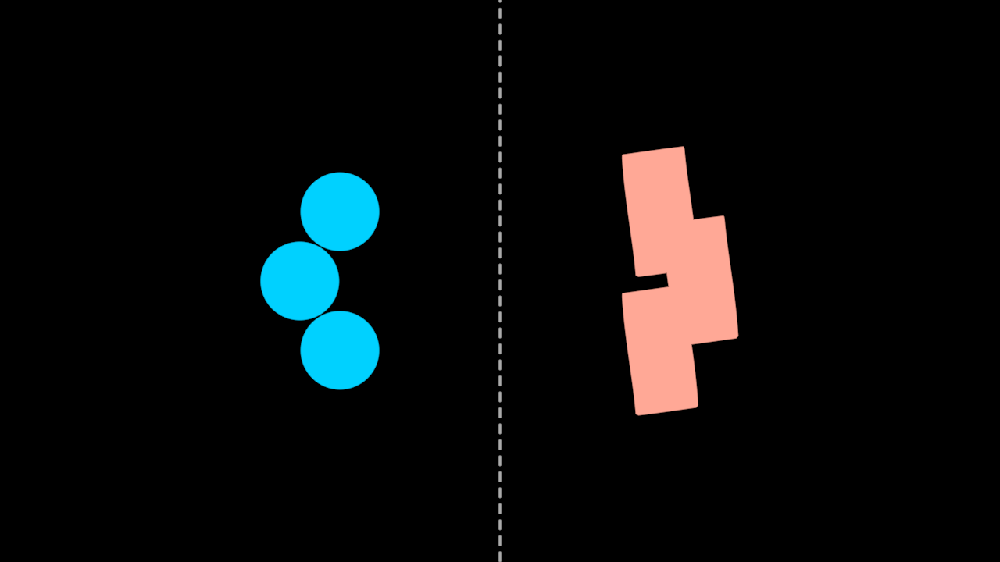

# Morph — the first pluggable ability



One shape becoming another. Import this module and every `Stroke` in the
process learns `.morphTo()`; don't, and nothing in the framework has ever
heard of morphing.

The face is Scene01 at t = 24.4s, mid-morph: three blue circles on the
left, and on the right three shapes that are no longer circles and not
yet rectangles — bowed, leaning, each skewed differently. A noun's face
shows the finished thing; an ability's face has to show the *becoming*,
because the becoming is what it contributes. Those leans are also the
correspondence proof — see below.

```ts
import { Morph, MorphShape } from "../../vocabulary/Morph/Morph"

class MyDream extends Dream {
  circle = new Circle({ radius: 50 })
  square = new Square({ size: 100 })

  // THE VERB SPELLING — the morpher is a declared field, like every
  // other holon, and the verb animates it.
  morpher = new MorphShape(this.circle, this.square, { opacity: 0 })

  // THE METHOD SPELLING — `.morphTo()` builds the morpher and hands it
  // back with its Anim. The scene still declares both; the method never
  // inserts geometry into the graph itself.
  becoming = this.circle.morphTo(this.square)

  unfold() {
    this.stage(this.morpher)
    this.stage(this.becoming.shape)
    this.play(Morph(this.morpher, this.circle, this.square), 4)
    this.play(this.becoming.anim, 4)
  }
}
```

Both spellings are canon and both are the same code. The verb suits a
scene that stages several morphers up front and animates them later
(Scene01 does exactly this); the method suits a morph stated in one
place, and is the reason the morpher comes back rather than being
conjured — a Dream's holons are its declared fields, so neither spelling
smuggles one in.

## How to morph anything

One verb: **`Morph(a, b)`**. Declare `b` hidden (`opacity: 0`), then play it:

```ts
import { Morph } from "../../vocabulary/Morph/Morph"

class Becoming extends Dream {
  dot = new Circle({ radius: 40, tint: BLUE, fillOpacity: 1 })
  truck = new Truck({ observer: this.observer, opacity: 0 })

  unfold() {
    const m = Morph(this.dot, this.truck)   // an Anim — and m.back(), m.route, m.holons
    this.play(m, 4)                         // the dot becomes the truck
    this.play(m.back(), 4)                  // and back
    this.play(Morph(this.truck, "truck"), 5) // a symbol into its word (a string is enough)
  }
}
```

It picks the route from what the two are — pass `route:` to choose:

| a → b | route | what you see |
|---|---|---|
| anything → a `Word` or a string | `"word"` | the symbol settles into one line, the line is held a beat, the letters rise from it in reading order |
| one closed outline → one closed outline | `"point"` | the classic morph: every point on its own path, turned for the least travel |
| many curves → one closed curve | `"gather"` | each curve becomes a complementary arc, in proportion to its length |
| everything else (dot → truck, truck → pallet, 3D ↔ 3D) | `"travel"` | strokes fly as bodies on gentle arcs and bend into shape late; small closed details fly whole or condense in place |

The camera is found by itself (a 3D symbol's or a Word's observer), so 3D
targets are drawn as the camera sees them — and stay correct if the camera
moves during the morph. The morphers it builds join the scene through the
tracks that animate them; nothing needs staging.

**A morph as a state.** `Forms` holds one thing in several forms and makes
the morph between any two a walkable transition — the automaton's `via`:

```ts
forms = new Forms({ dot: this.dot, truck: this.truck, word: this.word }, { observer: this.observer })
…
this.play(this.forms.morph("dot", "truck"), 4)      // in a song
// ?scene=forms&play=free: click the form showing (or its key) → the next one, by the real morph
```

Every pairwise morph is built up front; each position states every form's
visibility, so an interrupted transition retargets to a true picture.
Scenes: `?scene=forms` (dot ↔ truck ↔ word), `?scene=morph-solids`
(truck → pallet → film reel → pouch, the camera turning), `?scene=morph-word`,
`?scene=morph-dot-truck`, `?scene=morph-lines-circle`, `?scene=lens`.

The engine underneath is the rest of this README: `MorphCurves` (N curves
into M), `MorphToWord`, `SolidDrawing` targets, and pydeation's
`MorphShape` (`Morph(shape, a, b)` — the corpus spelling, unchanged).

## N curves into M, in 3D — `MorphCurves` + `MorphMany`

`MorphShape` above is pydeation's morph and stays exactly that (one closed
outline into one, index by index — the corpus is scored against it). The
general verb lives beside it in `MorphCurves.ts`: **any set of holons'
curves into any other set's**. Twelve scattered arcs become one circle,
each arc a complementary piece of the circumference; a filled blue dot
lets go of its fill and its outline flies apart onto the visible 3D edges
of a truck; and back.

```ts
import { MorphCurves, MorphMany } from "../../vocabulary/Morph/MorphCurves"

class FlowDream extends Dream {
  dot = new Circle({ radius: 46, tint: BLUE, fillOpacity: 1 })
  truck = new Truck({ observer: this.observer, opacity: 0 })       // targets start hidden
  toTruck = new MorphCurves([this.dot], [this.truck], { observer: this.observer, opacity: 0 })
  toDot = new MorphCurves([this.truck], [this.dot], { observer: this.observer, opacity: 0 })

  unfold() {
    this.stage(this.truck); this.stage(this.toTruck); this.stage(this.toDot)
    this.play(MorphMany(this.toTruck), 4)   // fill out → pieces travel → fill in
    this.play(MorphMany(this.toDot), 4)     // and back
  }
}
```

**The surface.**

| | |
|---|---|
| `new MorphCurves(sources: Holon[], targets: Holon[], opts)` | the morph in flight — a pool of Lines, one per piece. `morph` param 0→1. |
| `MorphMany(shape, { copy?, fadeOut?, fadeIn? })` | the verb: sources' fill fades over `fadeOut` of the clip (default 0.2 if any is filled), the pieces travel, targets appear exactly where they landed and fill over `fadeIn`. Sources hide as the pieces depart (unless `copy`). |
| `curvesOf(holon)` | what a holon offers: `worldCurves()` if it has one (a `SolidDrawing` answers its VISIBLE edges for the current camera — implement it on any holon to make it morphable), else a primitive's outline, else every descendant Line. |
| opts `order` | `"angular"` (default) · `"sweep"` · `"given"` — see below |
| opts `observer` | the Dream's observer: angular order is then read in the VIEW plane |
| opts `snap` | tape fraction; target boundaries within it snap onto source boundaries (whole sources grouped, fewer pieces) |
| opts `travel`, `stagger`, `arc`, `bend`, `chain` | how pieces fly (see below): rigid-then-deform by default |
| opts `lag` | with `travel: "lerp"`: pieces keep their shape for the journey |
| opts `capacity`, `step`, `normal`, `axis`, `rotate` | pool size; sample spacing; the angular plane; the sweep axis; rotation search on/off |

The mathematics is `src/geometry/correspond.ts` (`correspond`,
`planMorph`, `blendPlan` — pure, deterministic, 3D throughout); the 3D
targets come from `src/geometry/hiddenline.ts` via
`src/parts/soliddrawing.ts`.

**The model: two tapes.** Lay the sources end to end into one tape, the
targets into another, both normalised to length 1. The correspondence is
the identity between the tapes (plus, for a cyclic order, a rotation
offset found by minimising travel), cut at the union of both sides' curve
boundaries. So a source that is 8% of the source ink becomes 8% of the
target ink; many small sources GROUP into one long target, one long
source SPLITS across short ones; every target is covered exactly once —
complementary, never stacked; at most N + M pieces. The strategy is only
the ORDER on the tapes:

- **angular** — curves sorted by the angle of their arc-length midpoint
  about the common centre, each oriented counter-clockwise, then the
  rotation that minimises travel. Pieces land on the side they came from;
  nothing crosses the middle.
- **sweep** — sorted along an axis, oriented along it, no rotation.
- **given** — the caller's order and directions, untouched (a route's legs
  onto a route's legs).

**Travel: rigid, then deform (default).** Each side's curves are first
joined end to end into strokes (`chain`, default on — the truck's 88 edges
become 42 strokes, a few of them long), so pieces are long and few, and a
piece stays one polyline while it flies. Each piece then flies as a BODY:
its centroid on a gentle arc bowing away from the morph's centre (`arc`,
0.2), turning (capped at ±60°) and scaling (growth capped at ×2; shrinking
free, so a truck bound for a dot travels at its smaller size) toward its
target's pose, and only in the last part of its flight (`bend`, from 0.5)
does it bend into its exact target shape. `stagger` spreads the pieces'
departures along `axis` — reading order for a word — so the eye can follow.
Both ends are exact point for point, so the landing and the handover to
the real holon cannot be seen. `travel: "lerp"` keeps the older point-wise
blend (with `lag`: pieces keep their shape for the journey).

**What is not here yet.** One tint per piece (blended source→target), no fill
morph — fill is its own channel, faded; view-dependent targets re-plan if
the camera moves DURING the morph (move it before or after); hidden-line
solids are boxes and capped cylinders, axis-aligned in the holon's frame,
touching but not interpenetrating.

Proven by `test/correspond.test.ts` (length conservation for N>M, N<M, N=M
under all three orders, proportional shares, exact ends for any lag,
determinism and input-order independence, snapping, a point growing into a
shape), `test/hiddenline.test.ts`, `test/morphcurves.test.ts`, and the two
scenes: `/demo/?scene=morph-lines-circle`, `/demo/?scene=morph-dot-truck`.

## A symbol becoming its word — `MorphToWord`

"Words are symbols of symbols, twice removed from reality. DreamTalk
symbols are the universal layer beneath language." So the word is not a
label beside the symbol: the symbol's own lines become the letters.

```ts
import { MorphToWord } from "../../vocabulary/Morph/MorphToWord"

class TruckWord extends Dream {
  truck = new Truck({ observer: this.observer })
  m = MorphToWord(this.truck, "truck", { observer: this.observer })   // word, toWord, toSymbol
  unfold() {
    this.stage(this.truck); this.stage(this.m.word); this.stage(this.m.toWord); this.stage(this.m.toSymbol)
    this.play(this.m.there(), 3.5)   // the truck's colour goes, its edges become "truck", the ink fills in
    this.play(this.m.back(), 3.5)    // and the word becomes the thing again
  }
}
```

By default it goes **through the line**: the symbol's strokes settle into
one level line — the word's baseline, laid out in reading order, the
symbol's small closed details (wheels, windows) condensing where they are
— the line is held for a beat, and the letters rise from it left to right.
The middle of the morph is a single clean line: the essence held between
the thing and its name. `via: "none"` goes straight from strokes to letters.
Stage everything it built: `for (const h of m.holons) this.stage(h)`.

The word (`vocabulary/Word`) is the glyph contours as closed Lines, filled
by even-odd so counters stay open, standing where the symbol is, as wide
as it, and facing the camera. Its letters come from a font baked as data
(`src/geometry/ttf.ts` reads TrueType outlines; `scripts/font2ts.ts` bakes
`src/geometry/fonts/arimo.ts`), so text is curves synchronously. The order
is `"sweep-angular"`: the sweep along the reading direction decides which
share of the symbol each letter gets, then each letter gathers its share
around itself. The default `lag` is 0, so the drawing melts continuously
into the writing (`via: "none"`). Composites work as wholes: MindVirus →
"Mind Virus" hides every part that owns its opacity, and each piece leaves
in its own part's colour. Scenes: `?scene=morph-word`,
`?scene=morph-word-virus`; tests: `test/word.test.ts`.

**3D targets beyond boxes and cylinders.** Any triangle mesh is a
`SolidDrawing` solid (`{ kind: "mesh" }`) and so a morph target, drawn by
its creases and its smooth contours with hidden lines removed
(`src/geometry/meshlines.ts`; sphere, cone, torus, lathe, extrusion in
`src/geometry/meshes.ts`). `?scene=meshes`, `?scene=morph-mesh` (a dot
becomes a torus).

## What makes this different from every other vocabulary entry

The other twelve are **nouns** — Eye, Cylinder, Logo, MolochEye: things
you instantiate, that contribute geometry. Morph is a **verb**. Its
contribution is a capability the whole space gains by taking it in.

That distinction is the whole design. `Create`, `Draw` and `Fill` live in
`src/verbs.ts` because a Stroke that could not be drawn would be
incoherent — they are part of what a stroke *is*. A Stroke that cannot
morph is perfectly coherent; it is a Stroke in a world where nobody has
taught it that trick yet. So morphing is something a stroke **learns**,
through relationship, rather than something it is born knowing.

`src/verbs.ts` holds no implementation of this module. It carries one
temporary compatibility block — `Morph` was briefly a core verb before
the ability decision landed, so the old import path still resolves,
re-exported from here and marked for removal after a release. That shim
has one cost, stated where it lives: because verbs.ts is imported nearly
everywhere, the graft's runtime side effect reaches those files too, so
`.morphTo()` exists on Strokes in modules that never asked for it. The
*type* does not — a declaration merge only enters a compilation that
includes this module — so nothing can be written against it by accident.
When the block goes, so does the asymmetry.

## The four pieces

| Piece | Where | Why there |
|---|---|---|
| The mathematics | `src/geometry/morph.ts` | Pure functions over plain data — resampling, correspondence, interpolation. Core infrastructure, like `geometry/svg.ts`. Importing it grafts nothing. |
| The holon | `MorphShape`, here | Scene state. It stands in for both shapes while neither is itself. |
| The verb | `Morph()`, here | The timing — pydeation's AnimationGroup, ported. |
| The graft | one `defineProperty`, here | The teaching. |

## The correspondence rule (and why it is deliberately naive)

Both outlines are resampled to a common point count at uniform **arc
length**, then interpolated **index by index**. No rotation search, no
nearest-neighbour matching, no start-point alignment.

That is not a simplification — it is what pydeation did, because
pydeation did not solve correspondence at all. It handed the question to
Cinema 4D: two `MoSpline`s in Uniform mode (`SPLINE_MODE = 3`) feeding a
Cloner in Blend mode, driven by a PlainEffector's `modify_clone`
(`refs/pydeation-legacy/animation/animator.py:581-632`,
`object/mograph.py:37-54,118-151`).

The reference frames prove it. In "The Origins of Project Liminality"
(2024) at `f_00190`, three circles halfway into becoming rectangles are
**leaning, bowed quadrilaterals, each skewed differently** — exactly what
index-wise blending produces when two winding start points disagree. A
cleverer matcher would have made them upright. Anything cleverer here
would be a different animation from the one in the video.

## The eligibility gate, in two levels

**Compile time.** The `declare module` block merges `morphTo` onto
`Stroke` and only onto `Stroke`. `group.morphTo(…)` is a type error, not
a runtime refusal — a holon with no outline never will have one, and the
compiler is the right place to say so.

**Runtime.** Not every Stroke has a *single* outline. `AnnularSector`
draws itself through four sub-strokes; a `Line` of fewer than two points
has no shape at all. `MorphShape`'s constructor refuses both — at
construction, not at the first frame, so the stack trace names the line
in the scene that caused it.

Refusals **teach**, in the manner of the settled-holon error in
`holon.ts`:

```
Morph: cannot use AnnularSector as the source — a morph interpolates ONE
closed outline into another, and AnnularSector has no single outline of
its own: it draws itself through 4 sub-strokes. That is a category error
rather than a missing feature — morph its pieces individually, since each
sub-stroke is morphable on its own. Morphable shapes are: Circle,
Ellipse, Square, Polygon, Rectangle, or a closed Line.
```

The message distinguishes *category error* from *missing feature*, which
is the distinction a caller actually needs, and the degenerate case gets
its own wording (an empty `Line` is told to be given its points, not to
be taken apart). `isMorphable(holon)` answers the same question without
throwing, for code that would rather ask than catch.

The composite rule is pydeation's own, arrived at by omission:
`Morph.__new__` reaches straight for `start_spline.sketch_mat` and wraps
one `MoSpline(spline)`. It never calls `Animator.flatten_input`, the
helper every *other* animator uses to unpack a Group into its components.

## Noun/verb duality

`Morph(shape, a, b)` and `a.morphTo(b)` are one implementation; the
method delegates to the function, and adds only the construction of the
morpher it returns. Use whichever makes the sentence's subject clear —
the corpus scenes mostly use the function form because pydeation's
grammar is a list of animators handed to `play()`, and a reproduction
should read like its source. A symbol describing what *it* does in its
own `createAnim()` wants the method form.

## Why the side-effect import is sanctioned here

Importing this module mutates `Stroke.prototype`. In almost any other
module that would be a bug. Here it **is the product**: a module whose
entire purpose is to teach an ability is doing exactly what its name
says. The header states it in the first three lines, and the graft is
idempotent and non-enumerable — a second import is a no-op, and `Holon`'s
field scan (which walks `Object.entries` of an instance) never sees it.

## Proven by

- `test/morph.test.ts` — 46 tests: arc-length resampling, index-wise
  correspondence (pinned *against* a rotation search), purity and
  scrub-symmetry, the two-level gate, the graft reaching pre-existing
  instances, and the two spellings building identical Anims.
- Scene01 of corpus #09 (`?scene=o01`) — six simultaneous morphs,
  14/29 PASS at 2s steps and 18/29 densely over the morph window;
  `docs/reports/origins/o6-o01-f_00190-composite.png` is the
  correspondence proof.

## The template — what a second ability module copies

Write a `Write`, or a steering behaviour, or a `Trace`, and this is the
shape:

1. **Pure maths to `src/geometry/`.** Anything that is a function of
   plain data belongs to core and grafts nothing. The test of whether
   something is "ability-shaped" is simple: does it hold scene state, or
   name a Param? Then it is the module's.
2. **Declare the merge narrowly.** Augment the *most specific* interface
   that can honestly carry the ability. Merging onto `Holon` when only
   strokes qualify throws away the compile-time half of your gate.
3. **Gate at construction, and teach.** Say what the caller passed, why
   it does not qualify, whether that is a category error or a gap, and
   what *does* qualify. Export the predicate (`isMorphable`) so callers
   can ask instead of catching.
4. **Graft with `defineProperty`, non-enumerably.** ES modules evaluate
   once, so no `hasOwnProperty` guard is needed for idempotence — a
   second import re-runs nothing, and even a forced re-evaluation would
   assign the same body. What the descriptor must carry is
   `enumerable: false` (the field scan walks `Object.entries`, and only
   Params and parts belong there) and `configurable`/`writable` (so the
   module stays re-loadable under a test runner's module cache).
5. **Export both spellings from one implementation.** The method
   delegates to the function. Two code paths would drift.
6. **Say the side effect in the first three lines of the header.** The
   exception to "no side-effect imports" holds only while it is
   announced.
7. **Prove it in a scene, not only in tests.** An ability nothing uses
   has not been shown to be separable.
