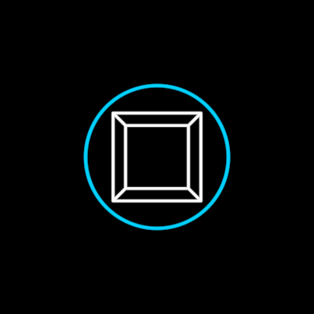

# Narrative

"A mechanical narrative constructed for the purpose of manipulation"
(narration 18:47) — the film's cube, set against the organic `Vision`
(f5686, labelled "Narrative"; f5821 "Narrative Engineering"). A white
perspective cube in a blue ring when it stands alone or is clapped over a
head (the boxed web, f5146, f5221); a bare blue cube round a domesticated
mind's head (`Mind`, f7021); in the manipulated lens (`Worldview`, f3541).

**Composed, never redrawn**: the cube is `FoldableCube` at fold 1, its open
side toward the viewer, with FoldableCube's `taper` (the bottom shrunk, the
walls trapezoids — a frustum) so the back square shows the film's ratio, and
a shallow `depth` (0.02 of the edge), so it is a relief: each film cube is a
drawing with its own vanishing point at its centre, and a deep solid
off-centre would be seen from the side by our one camera. The ring is a
Circle with a black disc behind it (it covers the head it boxes). Only the
ring and the disc are Narrative's own.

**Measured** (1280×720, stroke centrelines): back/front 0.719/0.710
(f5686), 0.718 (f5821), 0.718/0.71 (f5221) → `NARRATIVE.back` 0.716; ring
radius / front edge 0.812 (f5686), 0.815 (f5821), 0.806 (f5221) →
`NARRATIVE.ring` 0.813. Ring and cube share their centre.

**Params**
- `size`: the cube's front edge; the ring's radius derives from it.
- `ring` (0..1, the walkable state `bare` ↔ `ringed`): the ring and its disc.
- `tint` (white) / `ringTint` (blue): the film uses a white cube in a blue
  ring and a bare blue cube.
- `perspective` (0.716): the apparent back/front ratio (Worldview passes
  f3541's deeper 0.66).
- `depth` (0.02): the relief's depth / its edge; 1 makes a true 3D solid.
- `viewDistance` (1500, the default observer's): what the taper is
  computed against (`taperFor`).
- `stroke`, `ringStroke`: pen widths in screen px.

**Used by** Mind (bare, blue), Tribe (the box), Worldview (the lens's
narrative), chapters 2 (the vicious cycle's boxes) and 4 (the standalone
narrative, the noosphere's ring of boxed heads).

**Proven by** `test/ib-narrative.test.ts` (FoldableCube's taper/depth: the
cup still closes at fold ±1 and lies flat at 0, taper 1 is the old cube
point for point; the apparent ratio; the sub-pixel parallax; attach order;
the ring state). Standalone scene `demo/interbrain/NarrativeDemo.ts`
(`ib-narrative`). Comparison against f5686, f5821, f5221, f7021:
`docs/reports/interbrain/narrative-compare.png`.

**Residual**: the ring draws in the palette `BLUE`, a little more cyan than
the film's glowing blue; the film's lines glow, ours don't.
