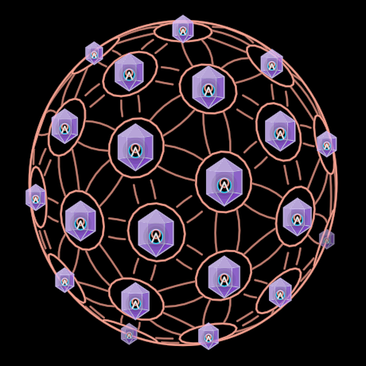

# Noosphere

"Our superstructure of stories … the lens through which we collectively
perceive" (InterBrain film, 7:30–7:41). Physical engineering builds the
infrastructure of the biosphere, social engineering the social structure,
narrative engineering the superstructure: the noosphere. Engineered with
narratives it is a dim blue sphere of mechanical links; gardened with visions
it turns red and its links bloom into the flower of life — "the antithesis of
narrative engineering" (19:02). Laid flat it is the shared worldview, the
third attractor's medium; broken by conflict into "seemingly conflicting
partial truths" (24:11) it is six blue shards in a vortex. With an InterBrain
in every node it is "a collective knowledge garden" (39:27) that transmutes
narratives into visions.

ONE holon; every look the film gives it is a point in its state space.

| State | Frames | Params |
|---|---|---|
| lattice — white geodesic wireframe, near bright, far dim | f2056, f2236 | `bloom 0` |
| …as the lens, a light at its heart | f2311 | `bloom 0, lens 1` |
| narrative-engineered — dim blue nodes joined by straight links, a narrative (square) in each | f4906, f5146, f5536 | `bloom 1, garden 0` |
| vision-gardened — red, the links bent into flower-of-life petals, a seed in each node | f5716 (right), f5851, f12451 | `bloom 1, garden 1` |
| whole disk — the red flower-of-life disk | f7231, f11851 | `flat 1, fragment 0` |
| …struck: six cuts, bolts at their ends | f7246 | `flat 1, fragment CUT (0.2)` |
| …squared to a hexagon, the disk's ghost behind | f7441 | `flat 1, fragment HEX (0.45)` |
| fragmented vortex — six blue lattice triangles apart, bolts between, red spiral field lines | f7456, f7471, f10606 | `flat 1, fragment 1` (+ `swirl`) |
| InterBrain sphere — the red flower sphere, an InterBrain in each node, ringed | f11896, f11941, f12796 | `bloom 1, garden 1, interbrain 1` |

**The axes** (each 0..1, so it scrubs and the automaton walks it — one per
transition the film animates, not an enum): `fragment` (disk ↔ vortex,
f7246 → f7471 and back f11806 → f11851; positions whole / struck / hexagon /
vortex), `flat` (sphere ↔ disk, f11851 → f11896), `interbrain` (the
InterBrains arriving, f11866 → f11896), `garden` (narrative → vision: blue →
red AND every straight link bends into two petals, f5716's arrow, f12451),
`bloom` (lattice → node sphere; the film cuts between them, the axis lets
them morph), `lens` (the light, f2311). `spin` is a clock; `swirl` turns the
vortex.

**Construction** (`geodesic.ts`, pure): a class-I geodesic icosphere at
`frequency` ν (10ν²+2 vertices). The lattice is its edges as chords (the
film's limb is a polygon). The links: per face and corner C, the link
between the other two vertices A, B — at `garden` 0 the great-circle arc
A→B (one straight link per edge, both faces' copies coincide), at 1 the arc
of the circle about C through A and B, so every edge carries two arcs
bulging together: the flower of life laid on the sphere. Links are trimmed
at the node rings (0.32 of the spacing). The disk is the planar flower of
life on a triangular lattice of spacing s = 0.934·R/15 — so the hexagon's
corners and the six triangles' edges lie on the lattice, and the shards'
blue grid (f7471) is that same lattice with its circles straightened away.
Each sector clips its own share, so the six part cleanly.

**Measured**: f11941 r 193 px, centre node's neighbours ≈ 96 px → 30° → ν 2;
f5716 r 186 px, nodes ≈ 32 px apart → 9.8° → ν 7; f2236 lattice r 124 px
(ν 4 reads closest); f7246 disk r 198 px, flower cells ≈ 12.5 px (R/s ≈
16), bolts 0.2 R at ≈ 1.38 R on the cuts; f7441 hexagon 0.934 R; f7471
centroids ≈ 0.97 hex-R out (from 0.58), bolts ≈ 0.4 R long, 0.83 R out.

**Params**: `radius` (the one size), `frequency` (ν; the lines read it live,
InterBrain faces are built at compose and only for ν ≤ 3 — a finer sphere's
rings are too small to hold one), `spin`, `pitch`, `swirl`; the look —
`latticeTint`, `latticeStroke`, `backOpacity`, `narrativeTint`,
`narrativeOpacity`, `visionTint`, `flowerStroke` (scaled 7/ν), `linkOpacity`,
`lensTint`, `diskTint`, `diskFill`, `diskInk`, `shardTint`, `shardFill`,
`cutTint`, `diskStroke`.

**Composes**: `Conflict` (the bolts), `InterBrain` (the faces). Imported,
never redrawn.

**Create**: the sphere draws on from the top down; the disk's flower grows
from the centre out.

**Not here**: the puppeteer fists at the vortex's heart (f7456, f7471 →
`Puppeteer`); the boxed heads ringing f5146 (→ `Mind`); the icons inside the
narrative sphere's nodes (a square stands for the narrative).

**Regenaissance**: its lattice globe (`Regenaissance/lattice.ts`) is the 15
great circles of the icosahedron — every line runs whole round the ball,
curved — while the film's noosphere is a faceted geodesic of chords. Two
constructions, so Regenaissance keeps its own (David may decide they are the
same symbol; then Regenaissance would draw `latticeLoops` and change face).

**Proven by**: `docs/reports/interbrain/noosphere-compare.png` (f2236,
f5716 ×2, f7246, f7471, f11941 against `?scene=ib-noosphere`),
`test/ib-noosphere.test.ts`.
