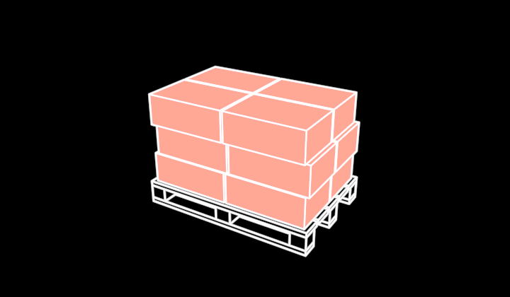

# Pallet



A pallet, platonic — raw material as it arrives: a deck of five boards on
nine blocks and three runners (the fork openings are what say PALLET),
loaded with three layers of flat sacks, laid a little off each other the
way a hand-stacked load is — or with one octabin under its lid, or bare.
Drawn as its **visible 3D edges** and one fill colour, recomputed for
wherever the camera is (`src/parts/soliddrawing.ts`), like the Truck.

```ts
pallet = new Pallet({ observer: this.observer, material: RED, load: "octabin" })
```

**Promoted params**: `material` (the load's colour — the material's
category), `load` (`"sacks"` · `"octabin"` · `"none"`), `body` (the bin
lid's fill), plus the Stroke set. The wood is lines only: hidden-line
occlusion is geometric, so it still hides what is behind it, and on the
black ground it reads solid from above — filled, its long low boards
would sort in front of the sacks by the painter's rule and black them out.

**Why it exists**: the grain of knowledge (`vocabulary/Grain`) — a dot of
raw material in a flow becomes the pallet it stands for once the data
knows its type, and a FlowLens (`concreteSymbol: (o) => new Pallet({ observer, ...o })`)
can show pallets instead of trucks. 240 long (x), 160 deep, 150 tall with
sacks; origin at the middle of the bounding box. `/demo/?scene=materials`.
