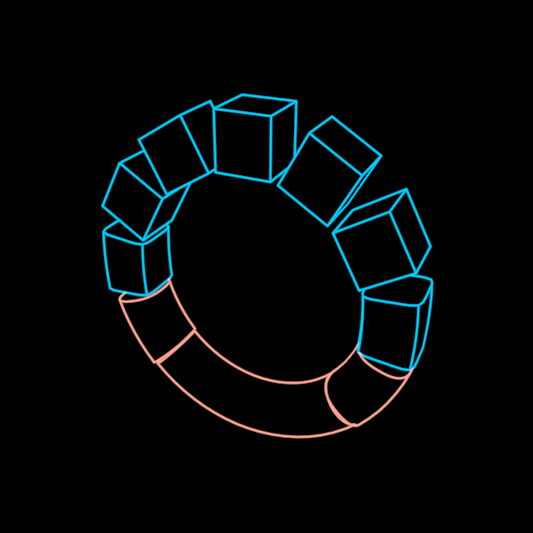

# Parody



The real and its counterfeit in the same place. A ring that is whole and
continuous — a torus, red — and the same ring made of discrete cubes, blue.
Evil as a parody of good, illusion as a parody of truth: the counterfeit
occupies the niche the real one would, alike on the surface and inverted
underneath.

So the two share what shows from afar — the centre, the radius, the band's
width — and differ in what shows close up. Face-on, both read as a ring (the
cubes as a ring of squares). Turned, the difference shows: one round body
against separate square blocks with gaps between them. The third dimension
is where the parody is found out.

```ts
ring = new Parody({ observer: this.observer, radius: 160 })
…
this.play(this.ring.parody.to(1), 3)   // the counterfeit takes the real's place, piece by piece
```

**The construction** is one mesh, a pure function of `parody`
(`parodyMesh`), drawn by its creases and smooth contours with hidden lines
removed (`SolidDrawing`). The ring is cut into `count` segments; along its
own progress each segment's spine bends from its arc of the ring to a
straight edge of length `PARODY.cube`·R (the gaps open), and its section
squares from the tube's circle to the cube's square (a superellipse, exponent
2 → ∞, the same width). At exactly 0 there are no cuts — one seamless torus;
past 0 a piece is capped, so the first thing that shows is the crack. With
`spread` the counterfeit starts at the top and runs down both sides at once,
meeting at the bottom (mirror-symmetric; `segmentProgress`).

**Two inks, one body.** A piece is the real's ink until it is half turned,
then the counterfeit's. The mesh is split by ink (`parodyHalves`) into two
`SolidDrawing`s, each drawing its own pieces and holding the other half as
an occluder only (a mesh solid with `lines: false`, src/geometry/hiddenline.ts),
so the hidden lines are those of the one body.

**Params**
- `parody` (0..1, the walkable state `real` ↔ `parody`): the axis.
- `spread` (2): 0 turns every piece at once; above 0 the counterfeit runs
  from the top down both sides.
- `radius` (100): to the tube's centre. `count` (12): the pieces.
- `realTint` (red) / `parodyTint` (blue), `stroke` (2.4 screen px).
- `observer` (constructor): the camera the hidden lines are drawn for.

The ring lies in its XY plane facing +z, a cube at the top: the dihedral
symmetry of `count`.

**Proven by** `test/parody.test.ts` (closed, outward-wound bodies at every
stage and in both halves; the seamless torus at 0 and twelve exact cubes at 1;
the spread's mirror symmetry; one axis, none when driven). Standalone scene
`demo/vocabulary/Parody.ts` (`?scene=parody`, `&play=free` to walk it).
