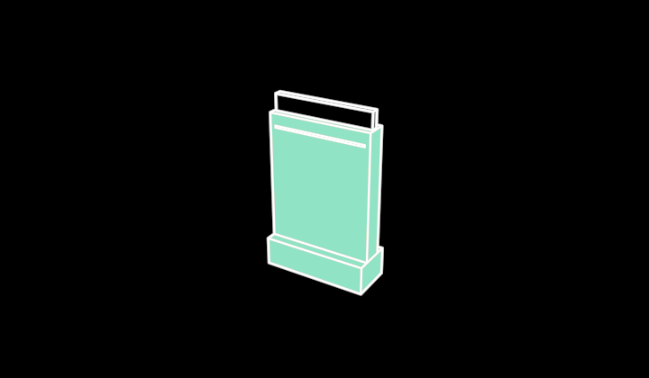

# Pouch



A stand-up pouch, platonic — the finished product: a tall flat body on a
deeper gusseted base, a sealed band across the top and the zip a line just
under it. Standing up is what says POUCH rather than sachet. Visible 3D
edges and a fill (`src/parts/soliddrawing.ts`).

```ts
pouch = new Pouch({ observer: this.observer, material: GREEN })
```

**Promoted params**: `material` (the film's colour — the product's
category), `body` (the seal's fill), plus the Stroke set. Face toward +z,
up +y; 120 wide, 186 tall, 48 deep at the base; origin at the middle of
the bounding box.

**Why it exists**: the grain of knowledge (`vocabulary/Grain`) — what
leaves the converter. `/demo/?scene=materials`.
