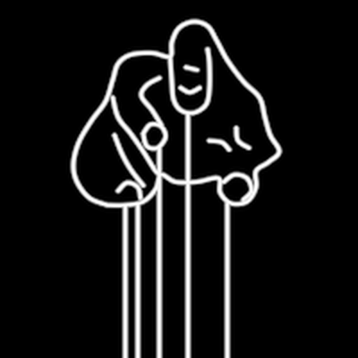

# Puppeteer



The hand that works the strings: a fist, fingers curled down, the thumb
standing up in the middle, five strings falling from the fingertips, the
knuckle and the thumb.

**The concept.** Manipulation "requiring neither their awareness nor
consent" (11:44): the narrative engineer who pulls the strings of minds
that never see the hand. In the InterBrain film it hangs over the
manipulated lens (f3541, and many of them at f4561), and it stands at the
corners of the divide-and-conquer triangles holding the minds below by
their heads (f3676, f3781, f4351), which is how `HyperAgent` uses it.

**The drawing.** The film's hand is a line sketch (an SVG asset, not one of
the deck's Keynote icons), traced here off f_03541 at stroke centrelines
(the largest instance, 113 px wide) and smoothed through Catmull-Rom. The
anchors are kept in the frame's own pixels so the trace can be checked
against the frame. The film has **no cross bar**: the strings leave the
fingers directly, so this holon has none.

```ts
hand = new Puppeteer({ size: 235, length: 290 })   // f3541's hand over the prism
```

**Params**
- `size`: W, the hand's width, the one unit. The origin is the grip (the
  bottom of the hand, centred).
- `length`: how far the strings hang below the grip.
- `strings` (5): how many strings. Five use the film's anchors; any other
  number spreads evenly across them.
- `tint` (white), `stroke` (2.2 px, the sketch's fine line).
- `opaque` (1): a black silhouette under the ink, so a line running behind
  the fist (a triangle's edge in f4351) is hidden by it.

**Abilities**: Create draws the hand, then drops the strings. The strings
that leave from inside the outline (the knuckle's, the thumb's) run in
front of the palm, as in the film; the others hang behind the hand.

**Residual**: the trace is simplified. The film's fist has more knuckle
detail on its left (two distinct curled fingers and short wrinkle strokes),
so ours reads a little rounder.

**Proven by** `test/ib-puppeteer.test.ts` (one unit wide, above its grip;
strings straight down to `length`; front and back strings; any string
count). Standalone scene `demo/interbrain/PuppeteerDemo.ts`
(`ib-puppeteer`). Comparison against f3541 and f4351:
`docs/reports/interbrain/puppeteer-compare.png`.
