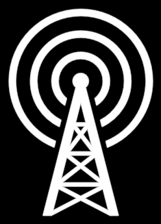

# RadioTower



The lattice mast with three rings of signal round its tip.

**The concept: BROADCAST.** "The written word and broadcast" (21:40): the
second of the two innovations that changed the physics of the medium, so a
story could reach far beyond the fire. On the Ancient → Modern arrow (f6496,
f10441), standing on the open Book in the red field (f6586), inside the
coherence beacon's circle (f11071), and as a generation of the arms race
(f931, f2836).

**The drawing** is Keynote's own `Radio Tower` icon, READ from PL02's deck
module (`Radio Tower_245`, slide 15) rather than copied: sixteen closed
outlines, the three ring bands first, then the mast and its twelve lattice
triangles. The film draws it solid: the mast and its triangles wash as one
even-odd area, so the triangles stay open.

```ts
tower = new RadioTower({ size: 160 })            // f6496's beacon
tower = new RadioTower({ solid: 0, tint: BLUE })  // the arms-race band's outline icon
```

**Params**
- `size` (160): the whole height; origin the icon's box centre.
- `broadcast` (1): the signal, 0 the bare mast … 1 all rings, inner first,
  each in its third of the axis. Walkable (`silent` ↔ `broadcasting`).
- `solid` (1): 0 the outline alone … 1 the solid glyph (the film's).
- `tint` (white), `stroke` (2 px).

**Abilities**: Create raises the mast, then sends the rings out.

**Proven by** `test/ib-icons.test.ts` (sixteen outlines, rings nested,
`size` the height, `broadcast` endpoints and order). Standalone scene
`demo/interbrain/IconsDemo.ts` (`ib-radiotower`). Comparison against f6496:
`docs/reports/interbrain/book-radiotower-compare.png`.
