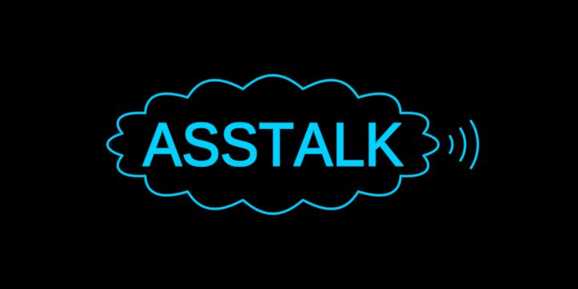

# RealTalkWord



Ass talk becoming real talk. The word ASSTALK in a cloud, a voice going out
from its side, resolves into REALTALK standing on a line. Ass talk is
association and babble — "talking out of one's ass", hot air, words that
drift apart. Real talk is plain speech about what is: words that make things
come together.

So the morph condenses. The cloud lets go of its billows and lies down as
the line the word stands on; the speech arcs at its side are drawn in. Of
A-S-S the A is kept — it steps over into its place in R-E-A-L — while the two
S's, the curving letters, are re-cut into the straight ones, R, E and L.
TALK stays TALK and only makes room.

```ts
word = new RealTalkWord({ size: 150 })
…
this.play(this.word.real.to(1), 3)   // ass talk → real talk
```

**Composed, never redrawn.** The letters are `Word`s (A, TALK, SS, RE, L),
each placed so its glyphs sit exactly where the whole word's layout puts them
(`layoutGlyphs`). The S's → R, E, L flight is the core correspondence —
`planMorphDetailed` once, `blendTravel` per frame, the plan and travel that
`MorphToWord` uses: the S's outlines are cut in reading order into pieces that
fly as bodies and bend into the new letters' outlines; the R's counter grows in
where it is. Fills hand over at the ends: the S's fill fades before their
outlines leave; R, E and L fill once theirs have landed.

**Phases of `real`**: [0, 0.15] the S's fill fades · [0.15, 0.85] the pieces
fly, the A steps over on a low arc, TALK slides · [0, 0.75] the cloud lies
down · [0, 0.35] the speech is drawn in · [0.85, 1] R, E and L fill.

**Params**
- `real` (0..1, the walkable state `ass` ↔ `real`): the axis.
- `size` (120): the em size; every proportion (`REALTALK`) follows from the
  cap height.
- `assTint` (blue) / `realTint` (red): the inks; everything runs between them.
- `stroke` (1.5) the letters' outline pen, `lineStroke` (2.4) the cloud's and
  the speech's, screen px.

Laid in its XY plane, the cap height centred on the origin. The cloud's
billows are equal arcs on an ellipse, a billow at each end of both axes; the
speech arcs are concentric about its right tip.

**Proven by** `test/realtalkword.test.ts` (the parts spell ASSTALK at 0 and
REALTALK at 1, glyph for glyph; the pieces start on the S's outlines and land
on R, E and L's; the fill handover; the cloud lies flat; one axis). Standalone
scene `demo/vocabulary/RealTalkWord.ts` (`?scene=realtalk-word`, `&play=free`
to walk it).
