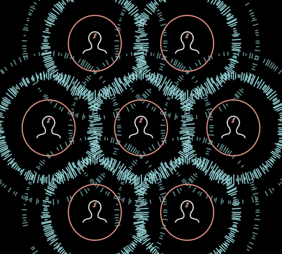

# Resonance (ability)



Resonance made visible: **dashed cyan rings travelling out round a mind, a
tribe, a DreamNode**. "Inspiring visions travel faster and further" (20:19);
"those who resonate … the best measure for the coherence of the song"
(37:14). Round each liminal mind of the ancient tribe (f6106, f6121), through
the lattice (f10321) and the liminal web (f11161, f11221, f11371).

A ring is a band of short **radial ticks** of random length — a sound wave
wrapped round a circle (f6106: round a mind of radius R the band runs
1.55–1.97R). Born at the rim, it travels out, thins, its ticks shorten and
fall away, and it fades (f6121: far out, a sparse dotted ring). Cyan is the
Field's wholeness cyan (`Field/CYAN`). Pure function of `time`: scrubbable.

**An ability with a holon**, like GeometrySketch (Morph/README §"The
template"): importing the module grafts `.resonate(overrides)` onto every
`Stroke` with an outline (`isResonant`); it returns `{ resonance, anim }`, a
`Resonance` that follows the shape's world centre and radius (stage it,
advance its `time`). A group has no outline of its own, so a tribe or a web
is rung by placing one: `new Resonance({ radius, x, y })`. A shape without
an outline is refused with an explanation.

```ts
import "../../vocabulary/Resonance/Resonance"
const { resonance } = mind.frame.resonate({ amount: 1 })
this.stage(resonance)
this.play(resonance.time.by(4, { easing: "linear" }), 4)
```

**Params**: `amount` 0..1 (**state**: silent ↔ resonating — brighter AND
further), `rings` (alive at once, 3), `dash` (ticks per fresh ring, 140),
`speed` (clock multiplier; a ring lives 3 s), `tint` (CYAN), `radius` (the
rim), `reach` (travel at full amount, in radii, 2.2), `band` (a fresh ring's
longest tick, in radii, 0.45), `time` (a clock), `stroke` (2.2).

Not `Field`'s burst mode: the burst is independent rays streaming off a rim
(wholeness, f12721); resonance is a coherent wavefront.

**Proven by**: `docs/reports/interbrain/resonance-compare.png` (f6106, f6121
against `?scene=ib-resonance`), `test/ib-resonance.test.ts`.
