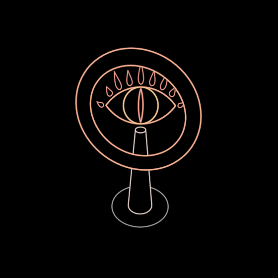

# RingEye



The eye seen through the ring — the true eye and its parody, framed by the
same circle.

The image is Tolkien's. The One Ring binds free will and folds everything
into one totalitarian system; Sauron is the flaming, lidless eye on the
tower, and in a sense that eye looks out through the ring. In the book (not
the films) Tom Bombadil takes the ring without craving, plays with it and
looks through it — and through the ring a clear, blue, innocent eye
flashes. So the same ring frames either eye. The burning one is the parody
of the true one: the eye that has gathered the world *into* itself, against
the eye that holds the world as a reflection and so becomes conscious of
itself.

```ts
ring = new RingEye({ observer: this.observer, radius: 150 })
…
this.play(Create(ring), 4)                        // the ring turns up toward you; the eye is seen through it
this.play(ring.stateAxis("gaze").to("clear"), 2.6) // the fire goes out, the slit opens, the world arrives
```

**One axis, `gaze`** (`watchtower` 0 ↔ `clear` 1):

- **watchtower** — lidless: no lids, only the almond rimmed with fire and a
  crown of flames rising over it where the lid would be (tallest over the
  apex, long and short in turn, one out of each corner — mirror-symmetric);
  the iris wide, kissing both corners; a pointed slit for a pupil; the eye
  standing on its tower; the ring's metal hot.
- **clear** — the lids (the almond and the upper lid's crease, white); a
  clear blue iris; the pupil round and holding the world — a small globe,
  the near halves of its equator and a meridian — with a catchlight beside
  it; no tower; the ring plain gold.

Between, the fire goes out first, the slit dilates into the round pupil,
and the lids and the world arrive.

**Colour.** In this vocabulary red is the real and blue the counterfeit.
Here the image itself makes the clear eye blue and the false one burn, and
the image is kept faithful: the inversion is the image's own.

**Real 3D.** The ring is a torus, drawn by its smooth contours with hidden
lines removed (`SolidDrawing`); `turn` stands it up from the horizontal
plane to face +z, which is how `Create` draws it. The eye stands *behind*
the ring's plane, inside its opening, and turns to whoever looks (heading,
then pitch — it never rolls): whichever eye it is, it looks at you through
the ring. The tower stands at the eye's depth — its top just under the fire,
its foot far below on a ground disc — a frustum in a second `SolidDrawing`
that holds the torus as an occluder only, so the ring hides the tower where
it passes behind it, and, turned, the tower is seen to stand beyond the ring.

**The eye's construction is MolochEye's**: the lens half-height h is the
unit, the lids are the 3-4-5 arcs (`LENS_RADIUS_RATIO`), and the glaring iris
is r = h, kissing the apexes. (EgoLens's cyclops is the MolochEye itself with
a red gaze; this eye is its own because its parts morph — the slit into the
pupil, the fire into the lids.)

**Params**
- `gaze` (0..1, the walkable state `watchtower` ↔ `clear`): the axis.
- `radius` (120): the ring, to its tube's centre — the symbol's one size.
- `turn` (1): 0 the ring lying flat … 1 upright (Create walks it).
- `stroke` (2.4 screen px).
- `observer` (constructor): the camera the hidden lines are drawn for and the
  eye turns to.
- Readings `fire()` / `calm()` for a whole that weaves it.

**Proven by** `test/ringeye.test.ts` (one axis, none when driven; all fire at
the watchtower and all calm at clear; the slit's proportions and the round
pupil; the eye and its fire inside the ring's opening; the corona's mirror
symmetry; the tower's occluder). Standalone scene `demo/vocabulary/RingEye.ts`
(`?scene=ring-eye`, `&play=free` to walk it).
