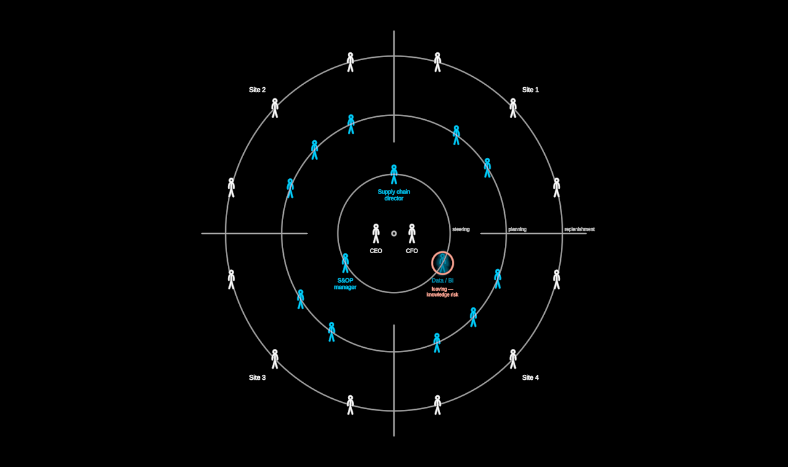

# RoleMap

The social structure lens: an organisation's ROLES — never names — by their
distance from the centre of decision. Leadership stands in the middle; the
staff who steer with it on the first ring; the planners on the second, the
ring cut into equal sectors, one per site; the decentralised workforce
spread round the outermost ring, an equal share in every sector. Equal
angles on every ring, equal sectors, the whole radially symmetric. Every
person is the shared `Figure`. A role at risk is drawn in the certainty
language — ghosted — and its risk can be shown: a red ring and the reason.

Leadership's intent is one move: `centralise` gathers the workforce into
ONE shared service — its people glide along their ring (never across the
centre), nearest first, into a hex-lattice cluster below the centre — and
the thin line it would need to the centre draws on ("needs the write
path").

Plain data in (`RoleMapData`: `roles` with `ring`, `count`, `site`,
`certainty`, `risk`; `sites`; quiet `rings` names; `shared` — the role
that centralises, its note, where it gathers). The mock is titles and
numbered sites only. Layout is pure (`layout.ts`): seats on rings and in
sectors, the cluster in whole symmetric lattice shells (12 = 3 + 3 + 6
round a triangle; 7, 19 round a node), the glide along the ring.

**State space** (`stateSpace()`; keys in free play):

- `centralise` — decentralised · shared-service (`g`)
- `sites` — hidden · shown: sector dividers and site names (`s`)
- `risk` — hidden · shown: the at-risk roles ringed, the reason said (`k`)

Also `labels`, `gap`. Create draws the rings outward and steps the people
in, centre first.

`?scene=rolemap` walks it: the rings and roles, the sites, the risk, then
the shared service. `&play=free` to walk it yourself.
