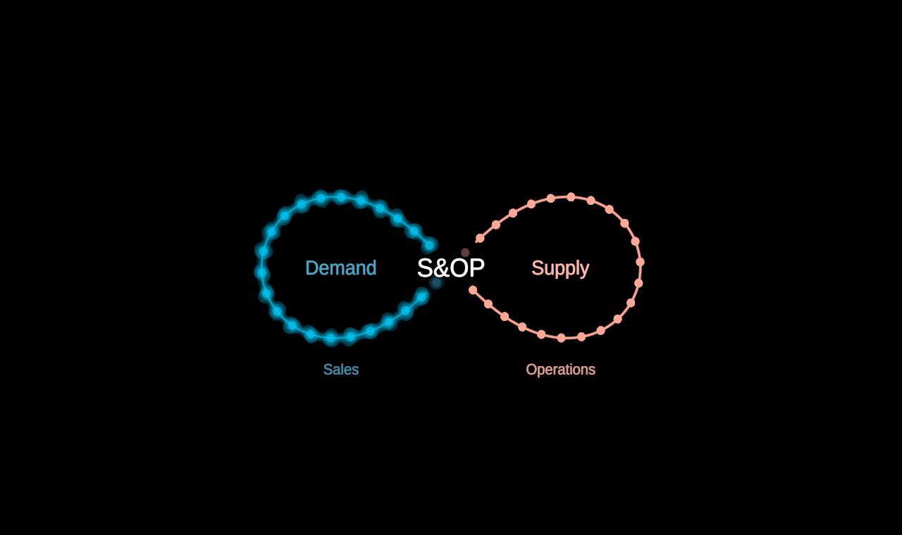

# SOPLoop

Sales & Operations Planning as one figure-eight: DEMAND on the left (blue —
Sales), SUPPLY on the right (red — Operations), "S&OP" at the crossing
where the two are reconciled, again and again. Value runs round the loop
continuously — particles on FlowMap's stream machinery (arc-length spacing,
world speed, a pure function of `time`).

Plain data in (`SOPLoopData`: `left`, `right` — label, role, tint,
certainty — and `centre`); generic by default.

**Degrees of freedom** (params; `stateSpace()` makes them walkable):

- `focus` −1 … 1 — demand or supply in focus; the other lobe recedes.
- `round` 0 → 1 — integrated planning: the two loops become ONE. A
  figure-eight's lobes run opposite ways, so the left lobe first flips over
  through depth (the figure tips back to show it), then the untwisted loop
  relaxes into a circle, half blue, half red (`src/geometry/lemniscate.ts`).
  The names step outside the circle; S&OP keeps the centre.
- each side's `certainty` — a demand forecast is conjecture until it lands
  (the mock's demand is 0.35): drawn as a superposition that crystallises.
  Particles take the certainty of the side they are passing through.
- `labels`, `time`, `speed`, `spacing`.

`?scene=sop` walks it: draw on, focus each side, the forecast lands, the
loops become one and part again.
