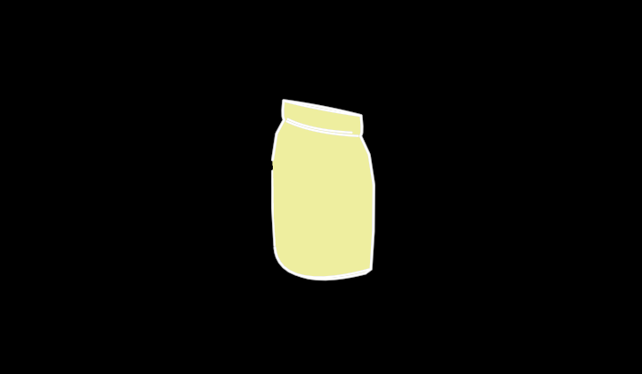

# Sack



A sack, platonic — bulk raw material by the bag (granulate, powder): a
filled bag standing on its foot, its belly round with what it holds,
gathered and stitched closed at the top. One lofted mesh (Pouch's
lens-section `loft`, here fat — a full bag is nearly round): the stitched
band and the side seams are creases, the belly smooth contours solved for
the camera. A Pallet stacks flat sacks; this is one sack, standing.

```ts
sack = new Sack({ observer: this.observer, material: YELLOW })
```

**Promoted params**: `material` (the bag's colour — the material's
category), `width` (130), `height` (170), plus the Stroke set. Face along
+z (turn it with `h`), up +y; origin at the middle of its height.

**Why it exists**: the packaging vocabulary of the grain of knowledge
(`vocabulary/Grain`). `/demo/?scene=materials-faces`.
