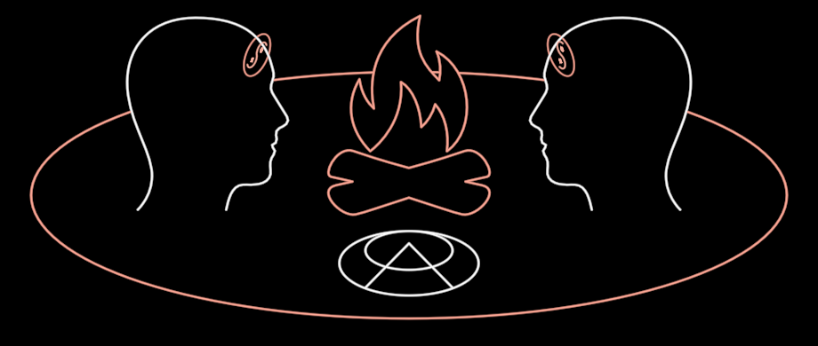

# SandTalk

Two people in profile at a campfire, inside the red ring of their
conversation, with a symbol drawn in the sand between them.

**The concept.** "We would meet around the campfire to freely exchange our
knowledge … using the spoken word accompanied by drawing symbols in the
sand, an ancient practice the aborigines referred to as sand talk"
(InterBrain film, 19:38–19:53). "The symbols as the seeds and the
free-flowing conversation itself as the soil" (19:55): the sand symbol is
the Seed, the ring is the Soil. Those two labels are scene text, not part
of the holon. Its digital extension is DreamTalk (29:08).

**Composed, never redrawn.** The people are `Figure` (THE person) in its
bust form, turned side-on with the new `profile` ability (Keynote's `Head`
icon, read from PL02 slide 7), black under their ink. Each has a `Vision` in
the brow, turned away with the head as at f8656. The hearth is `Fire`. Only
the ring and the default sand glyph belong to SandTalk.

**Params** (measured off f8656, in units of S = `size`, the ring's
half-width; the table is `SANDTALK`)
- `size`: S. Heads 0.509·S tall with crowns at ±0.565·S, the fire 0.527·S
  tall, the glyph's centre 0.172·S below the ring's centre.
- `ringTint` (red), `ringWidth` (half-width as a share of S), `ringAspect`
  (0.327), `ringX` (centre offset): the ring can be stretched and moved to
  be the shared ellipse of the digital campfire (f9451, f9541). That scene
  is a composition of InterBrains and rings, not part of SandTalk.
- `symbol`: the sand slot. Undefined gives the seed glyph (PL02 slide 7,
  f5941/f5986: a triangle's apex in two circles, the inner circle tangent at
  the back). Null leaves the sand bare. Any holon is fitted to the slot by
  its reach (DreamNode's `reachOf`), e.g. Vision at f9541. The slot is
  tilted into the ground plane, so a circle reads as the film's ellipse.
- `vision` 0..1: the Vision in each brow.
- `tint` (the people's ink, white), `stroke` (2.2 px).

**Abilities**: Create draws the ring, lights the fire, sits the two down,
lights their Visions and draws the symbol in the sand last. `reach` is the
ring's half-width.

**Residual**: f8656's sand symbol is the radiant one (an ellipse with
twelve rays, the proto-DreamTalk symbol). The default is the earlier seed
(f5941/f5986). A scene that wants the radiant one passes it in the slot. The
film's heads fade out at the bottom and the fire glows; ours end crisp.

**Proven by** `test/ib-sandtalk.test.ts` (also pins Figure's `profile`).
Standalone scene `?scene=ib-sandtalk`. Compare:
`docs/reports/interbrain/sandtalk-compare.png` (f8656, f5941).
