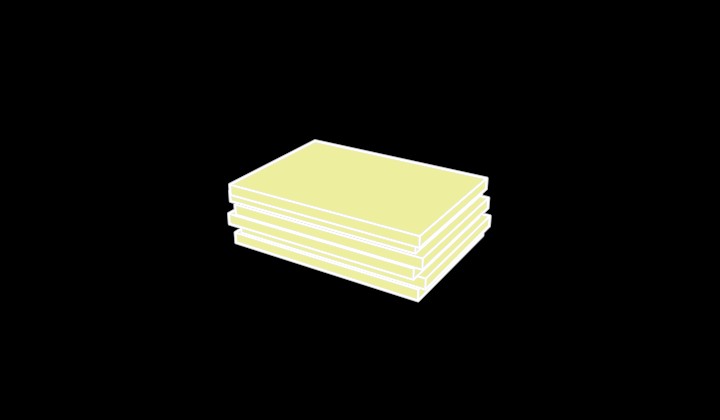

# SheetStack



A stack of sheets, platonic — a finished product sold flat (cut sheets,
labels on their liner, square metres): thin slabs lying on each other,
each a little off the one below, so every sheet's edge shows on the
stack's sides. Visible 3D edges and a fill (`src/parts/soliddrawing.ts`).

```ts
sheets = new SheetStack({ observer: this.observer, material: YELLOW, sheets: 8 })
```

**Promoted params**: `material` (the sheets' colour), `sheets` (6), plus
the Stroke set. 200 × 140, 10 per sheet; origin at the middle of the
bounding box.

**Why it exists**: the grain of knowledge (`vocabulary/Grain`) — the
products that are sold in square metres rather than pieces or reels.
`/demo/?scene=materials`.
