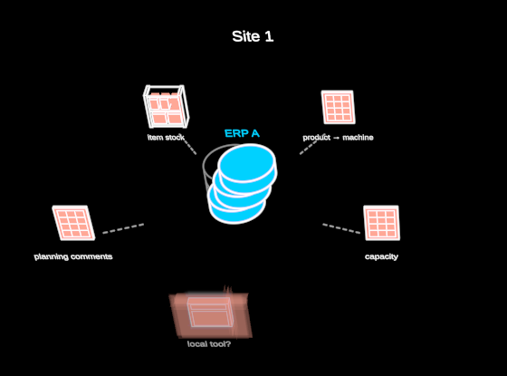

# SiteSystems



Inside a site: its systems. The zoom level you enter when you unpack one
production site of an organisation. At the centre stands the **ERP** — the
system of record — as a database of three stacked tiers, labelled with its
family. Behind it stands a grey ghost of the same stack, upright: the
**family's standard** form. The site's own stack drifts off it tier by tier.
The foundation is shared, and each layer above is used a little more the
site's own way, by `usage` (how far this site's convention departs from
the standard, 0 … 1). Put two sites on the same family side by side and
they visibly differ.

Around it, on a ring on the ground, is what lives **outside** the system of
record:

- **spreadsheet**: a sheet with its cell grid
- **localTool**: an app window
- **warehouse**: a rack with cartons
- **other**: a box

They sit at equal angles, mirror-symmetric about the view: 4 on the
diagonals, 6 on a hexagon. An odd count puts its last one at the front.
None hides directly behind the ERP. Each points at the ERP with a short
dashed hand-off line that never plugs into it. A system we only suspect
(`certainty` < 1) is a ghost in the certainty language, and it has no
hand-off unless the data says so.

```ts
site = new SiteSystems({ observer: this.observer, data: { site: { label: "Site 1" }, erp: { family: "ERP A" }, usage: 0.4, outside: [{ kind: "spreadsheet", label: "capacity" }] } })
```

Plain data in (`SiteSystemsData`: `site`, `erp` {family, label?,
certainty?}, `usage`, `outside` [{kind, label, certainty?, link?}]). The
mock is `MOCK_SITE_SYSTEMS`: "Site 1" on "ERP A", usage 0.4, and three
spreadsheets, an item-stock warehouse system and one suspected local tool.
It is built in 3D: the stacks and satellites are SolidDrawings (visible
edges and fills for the observer you pass), the ring lies in xz, and up is +y.
The pure layout (`ringAngles`, `onRing`, `tierDrift`, `linkStart`,
`flight`) is tested in `test/sitesystems.test.ts`.

**Degrees of freedom** (params; `stateSpace()` makes them walkable):

- `outside`, hidden · shown (`o`): the satellites fly out from behind
  the ERP to the ring, one after another.
- `usage`, standard · local (`u`): the stack stands on the family's
  standard, or drifts to the site's own convention.
- `labels`, hidden · shown (`l`).
- `ring`: the ring's radius.

`?scene=sitesystems` shows two sites on ERP A, first on the standard and
then drifting (0.4, 0.9), with their outside systems flying out.
`&play=free` walks both sites.
