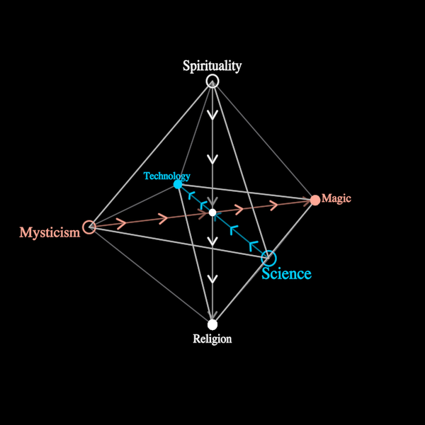

# SixPaths

The six paths of deepening one's relationship with reality, from Forrest
Landry's *Immanent Metaphysics*. They come in three pairs, and each pair has
a perception and its expression:

- **Science** (the mapping of causal process) and **Technology** (the
  application of that mapping): the causal branch.
- **Mysticism** (the perception of the trans-causal) and **Magic** (its
  expression): the trans-causal branch, the conjugate of the causal one.
- **Spirituality** (the integration of the world into the self) and
  **Religion** (the integration of the self into the world): the immanent
  core between the two outer branches. The two complement each other.

**The figure** is a regular octahedron: three mutually orthogonal axes
through one centre, one pair on each, with the perception at one end and the
expression at the other. The immanent pair stands on the vertical, with
Spirituality above and Religion below. The two outer branches lie on the
horizontal plane, Science and Technology on one axis and Mysticism and Magic
a quarter turn away on the other. The three perceptions then form one face of
the octahedron and the three expressions form the opposite face: two parallel
triangles.

**The hexagram** (`view` 1). Turn the solid until the line joining those two
faces' centres points at the eye, and the two triangles interlock as a
six-pointed star. Perception is the rising triangle, with Spirituality at its
apex; expression is the descending one, with Religion at its apex. Each
pair's axis is a diameter of the star. Nothing is flattened: it is the same
solid, turned.

**The flow** runs on the symbol's own clock (`time`). Chevrons travel along
every half-axis: inward on the perceptions (the world taken in toward the
centre) and outward on the expressions (the centre given back to the world).
So each axis carries one stream, from its perception through the centre to
its expression.

**Colour**: one per pair. The causal pair is blue, the trans-causal pair red,
and the immanent pair white (the vertical). A perception's vertex is a ring,
because it receives; an expression's vertex is a filled disc, because it
gives.

**Params**: `radius` (the octahedron's circumradius; the one size), `mode`
0 perception … ½ whole … 1 expression, `focus` 0 all · 1 causal ·
2 trans-causal · 3 immanent, `view` 0 upright … 1 hexagram, `time` (a clock),
`spin` (an extra turn about the vertical), and the pens `arrowStroke`,
`axisStroke`, `edgeStroke`.

**Axes**: `mode` (perception · whole · expression: which half of the flow
runs, and which triangle and which names are lit), `focus` (all · causal ·
trans-causal · immanent: one pair lit, the others dimmed), and `view`
(upright · hexagram). `time` is a clock, so it keeps running in free play. No
keys are declared: the player assigns digits, and a weaving scene can rekey
them. A whole that drives one of these params makes that axis its own.

**Construction** (ρ = `radius`): the vertices sit at ±ρ on each axis. The
figure is turned by a yaw about the vertical and then a pitch toward the eye.
Upright is yaw −π/4 − 0.42 and pitch 0.3, which looks down a little onto the
horizontal plane. The hexagram is yaw −π/4 and pitch atan(1/√2), which brings
(1, 1, 1)/√3 onto the eye's axis. The names sit outside their vertices,
pushed outward from the centre as the eye sees it, and always face the eye.
Every line of one kind is one Polylines: three axes, two faces, the band of
six edges between them, and three chevron strokes, all a pure function of
time, mode, focus, view and the eye.

**Parts**: primitives only (Lines, Polylines, Circles and Text that turn to
face the eye).

`?scene=six-paths` draws the figure, walks the focus over the three pairs,
narrows the flow to perception and then to expression, and turns the solid
into the hexagram and back. `?scene=six-paths&play=free` walks it.
